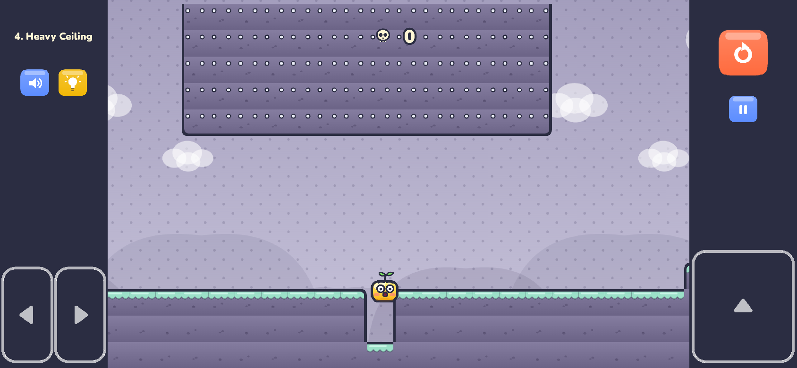
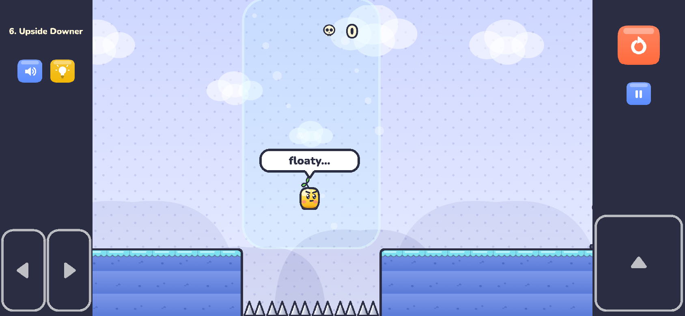
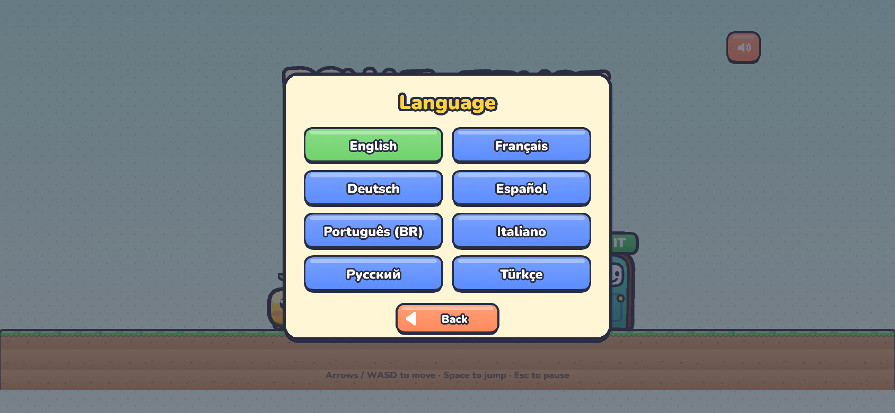
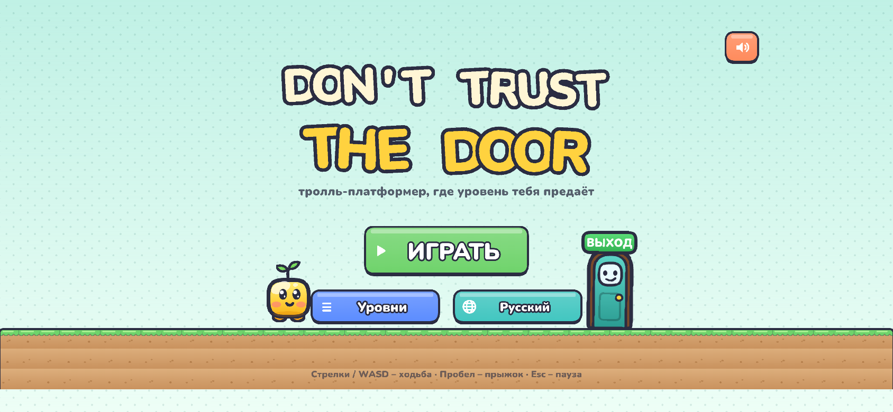

# Don't Trust the Door

A troll platformer where the level betrays you. Original web game by AtelierPro Aramyan Games.

Ten long levels, ten themes, **86 traps – every one a different idea**: the floor, coins, springs,
the cave ceiling, your own controls, gravity, the EXIT door itself, the camera, things that chase
you, and finally the moving platforms. No trap type, mechanic or map section appears twice. Every
trap is surprising the first time and solvable the second: you always see the hero, each trap has
one machine-checked solution, and a checkpoint flag follows every three traps. Death restarts
instantly; the death counter is always on screen. Playable in **8 languages**.

**Play:** https://rafikaramyan1987-ux.github.io/Dont-Trust-The-Door/ (phone: play in landscape)

<p>


</p>

## How to play

Reach the EXIT door – the real one. **← → / A D** move · **Space / ↑ / W** jump (hold = higher) ·
**Esc / P** pause · **R** restart the level · **M** mute. On phones (landscape) big buttons sit in the
side margins outside the level; the orange **restart** button is at the top right. Holding ▲ gives the
same full jump as the jump key.

- **Checkpoints:** a flag after every 3 traps – a death never costs more than 3 traps of progress.
  The restart button always goes back to the very start.
- **One hint per level (light bulb):** you choose when to use it. It explains the next trap ahead and
  highlights exactly its dangerous tiles, then greys out until you finish the level or start it again
  from level select. Apart from that, the only text in the levels is the move/jump instruction at
  the start of level 1 (shown once); death quips are jokes, not hints.
- **The camera never hides you:** when a camera trap looks elsewhere, a yellow arrow at the screen
  edge shows where the hero is.

## Languages

English, Français, Deutsch, Español, Português (Brasil), Italiano, Русский, Türkçe. The game starts in
the browser's language when it is one of these (otherwise English); the 🌐 button on the title screen
and in the pause menu switches it and the choice is saved. Every text – menus, buttons, level names,
hints, death quips, win messages, the fake "level clear" card, the tutorial, the EXIT sign, the
"rotate your phone" screen – lives in one file per language: [`src/i18n/<code>.json`](src/i18n).
Levels and code only use text keys. The bundled font (Nunito, SIL Open Font License) has Latin,
Latin-extended (ç ğ ı ş ö ü, accents) and Cyrillic glyphs; button texts shrink to fit and the hint box
wraps, which the self-test checks for every language at 640×360.

<p>


</p>

## The 86 traps

Each line: the trap, its type key (unique across the game) and its hint – which describes exactly
the solution the bot uses to pass it.

### 1. Hello, Floor — The floor is not what it seems

236 tiles wide (was 118, ×2.00) · 8 traps · checkpoint after every 3 traps · bot win 33.2 s

1. **The floor sinks into the abyss** (`sinking-floor`) – The cracked floor ahead slowly sinks into the abyss – step on it and jump off to the right straight away.
2. **Two fake floor tiles over spikes** (`fake-floor`) – Two tiles in the middle of the plateau are fake – jump over them.
3. **Cracked floor crumbles if you stop on it** (`collapsing-floor`) – The cracked floor in the dip crumbles shortly after you step on it – keep walking across.
   - 🚩 *checkpoint*
4. **The conveyor belt drags you into the pit** (`conveyor-floor`) – After the little pit the floor is a conveyor belt that drags you back into it – keep running right.
5. **The hatch breaks under a hard landing** (`hard-landing-hatch`) – The bolted hatch after the spike breaks if you land on it hard – clear the spike with a tiny tap jump.
6. **An invisible bridge over the wide pit** (`invisible-floor`) – An invisible bridge crosses the wide pit, but it starts 2 tiles out – jump from the edge, then walk.
   - 🚩 *checkpoint*
7. **Slippery ice slides you into the pit** (`ice-floor`) – The blue floor is ice: you cannot stop on it – keep running and jump at its very end.
8. **The bridge crumbles behind you** (`crumbling-bridge`) – The long bridge crumbles plank by plank right after you step on it – keep running across.

### 2. Greedy Little Blob — "Safe" coins are traps

284 tiles wide (was 142, ×2.00) · 8 traps · checkpoint after every 3 traps · bot win 39.4 s

1. **A coin in the trough bites** (`biting-coin`) – The coin lying in the trough has teeth – jump over the whole trough.
2. **The coin arc over the pit bites** (`coin-arc`) – The coins above the pit bite – cross it with a small hop that stays under them.
3. **Grabbing the lone coin makes spikes shoot up** (`cursed-coin`) – Do not jump for the lone coin above the stage – walk underneath it.
   - 🚩 *checkpoint*
4. **The coin trail leads into a pit** (`coin-trail`) – The coin trail from the high walkway leads into the pit – stay low and jump the pit from the ground.
5. **Only the top of the coin wall is real** (`coin-wall`) – The lower half of the coin wall bites – jump so you fly through its top half.
6. **Spiky coins rain from the sky** (`coin-rain`) – Coins rain down in three columns – wait until a shower hits the ground, then dash through.
   - 🚩 *checkpoint*
7. **A coin balloons into a giant spiked coin** (`giant-coin`) – The coin in the low corridor puffs up into a giant spiked coin – stop, wait until it shrinks, then go.
8. **The coin explodes into spikes** (`coin-bomb`) – The coin in the tunnel explodes into spikes a moment after you grab it – keep running.

### 3. Spring Fever — Springs

275 tiles wide (was 135, ×2.04) · 8 traps · checkpoint after every 3 traps · bot win 40 s

1. **The spring shoots you into ceiling spikes** (`spring-ceiling`) – The spring shoots you at spikes – hold LEFT while flying to go up through the gap.
2. **The first spring is a dud** (`dud-spring`) – The first (rusty) spring over the void is a dud – jump past it onto the red one.
3. **A spring pops out of the floor** (`hidden-spring`) – A spring pops out of the floor under the spiked bar – jump over that spot.
   - 🚩 *checkpoint*
4. **A sideways spring flings you into spikes** (`sideways-spring`) – The blue spring flings you sideways into spikes – jump over it.
5. **A spring lobs a spiked ball at you** (`catapult-spring`) – Stepping on the stone plate makes the spring lob a spiked ball at you – keep running under it.
6. **The rubber floor bounces you into spikes** (`rubber-floor`) – The springy floor only bounces when you land on it hard – walk on it and jump only under the gap in the ceiling.
   - 🚩 *checkpoint*
7. **The spring bounces higher every time** (`escalating-spring`) – The spring in the well bounces you higher each time – jump off to the right on the second bounce.
8. **The diagonal spring flings you too far** (`overshoot-spring`) – The diagonal spring throws you way too far – let go of the keys after it launches you to land on the small island.

### 4. Heavy Ceiling — The ceiling is out to get you

260 tiles wide (was 129, ×2.02) · 8 traps · checkpoint after every 3 traps · bot win 39.1 s

1. **Ceiling spikes drop on you** (`dropping-ceiling-spikes`) – The spikes under the low rock drop when you come near – step back, let them fall and rise, then go.
2. **The cracked slab crashes down** (`crusher-slab`) – The cracked slab crashes down a moment after you step under it – sprint through without stopping.
3. **Bonking the brick drops spiked rocks** (`loose-brick`) – Do not jump into the bolted brick – bonking it drops spiked rocks on you. Just walk under it.
   - 🚩 *checkpoint*
4. **A stone block slams down in rhythm** (`thwomp`) – The stone block slams down in a steady rhythm – wait until it lifts, then run under it.
5. **Stalactites fall one after another** (`domino-stalactites`) – Once you pass the first stalactite they all fall one after another behind you – keep running.
6. **The hole in the ceiling is a trap** (`fake-ceiling`) – The open hole in the low ceiling hides spikes – the way up is the cracked part that looks solid.
   - 🚩 *checkpoint*
7. **The whole roof slab crashes down** (`safe-notch`) – The whole roof slab crashes down – drop into the slot in the floor and wait there until it lifts.
8. **The spiked ceiling comes down** (`descending-ceiling`) – The spiked ceiling lowers as soon as you enter – hurry to the pit and jump it while there is still room.

### 5. Left Is Right — The controls betray you

299 tiles wide (was 149, ×2.01) · 8 traps · checkpoint after every 3 traps · bot win 42 s

1. **Left and right swap** (`controls-swap`) – On the purple floor left and right are swapped – hold LEFT to go right, and LEFT+jump over its pit.
2. **The jump stops working** (`broken-jump`) – Jump does not work on the 2 grey tiles before the pit – take off just before the grey tiles.
3. **Super jumps hit the spiked roof** (`super-jump`) – On the orange floor every jump is super strong – cross the pit with a short tap so you stay under the spiked roof.
   - 🚩 *checkpoint*
4. **You get the hiccups** (`hiccup-jump`) – On the green floor you hop by yourself every moment – wait in each gap for a hop, then run under the next spikes.
5. **Your buttons lag behind** (`input-lag`) – On the teal floor every button reacts late – press jump about two tiles before the pit.
6. **Your controls freeze** (`frozen-controls`) – The pale strip freezes your controls for a second and you keep sliding – step onto it slowly.
   - 🚩 *checkpoint*
7. **Turbo speed makes you overshoot** (`turbo-speed`) – On the red floor you run twice as fast – make a tiny hop onto the island, then a full jump from its edge.
8. **You cannot stop running** (`auto-run`) – On the yellow floor you cannot stop running – jump the pit, the block and the wide pit right at their edges.

### 6. Upside Downer — Gravity

243 tiles wide (was 121, ×2.01) · 8 traps · checkpoint after every 3 traps · bot win 32.6 s

1. **Gravity flips – drifting lands you in ceiling spikes** (`gravity-flip`) – Gravity suddenly flips and you fall up – let go of the keys so you land before the ceiling spikes, then jump over them.
2. **Gravity flips back above a spike field** (`gravity-flip-back`) – At the end of the ceiling walk gravity flips back above spikes – keep holding RIGHT while you fall.
3. **Floaty gravity – a jump hits the spikes** (`low-gravity`) – Gravity is weak at the end of the top step – do not jump (you would hit the spikes); just walk off the edge and float across.
   - 🚩 *checkpoint*
4. **Heavy gravity – you fall into tiny cracks** (`heavy-gravity`) – On the dark floor you are so heavy you fall into the thin cracks – hop over each crack.
5. **The ground falls up into the sky** (`ground-falls-up`) – A chunk of the ground ahead falls up into the sky when you come near – jump over the hole it leaves.
6. **A bubble makes you float up into spikes** (`floating-bubble`) – Inside the bubble over the pit you float upward – do not jump or stop, walk straight through it.
   - 🚩 *checkpoint*
7. **Jump flips gravity instead** (`flip-on-jump`) – On the blue strip jump flips gravity – flip up before the pit, then flip down right after it, before the ceiling spikes.
8. **Gravity flips back and forth** (`gravity-pulse`) – Gravity flips up and down every moment – keep running: cross the floor spikes while you are on the ceiling.

### 7. Too Many Doors — The EXIT keeps changing its mind

250 tiles wide (was 125, ×2.00) · 8 traps · checkpoint after every 3 traps · bot win 37.1 s

1. **A fake EXIT bites** (`fake-exit`) – That EXIT under the steps is fake and bites – climb the steps and go over the wall.
2. **A door kicks you back into the pit** (`kick-door`) – The door after the pit kicks you back into it – jump over the door.
3. **A door licks you with a spiked tongue** (`door-tongue`) – The door shoots out a spiked tongue when you come near – stop, let it lick and pull back, then jump over the door.
   - 🚩 *checkpoint*
4. **A portal door throws you at a pit** (`portal-door`) – The door in the wall is a portal and you come out just as fast, right before a pit – walk in slowly.
5. **The EXIT grows legs and runs away** (`runaway-exit`) – The EXIT on the ledge runs away – do not walk off after it: jump from the very edge of the ledge.
6. **Biting doors slam open and shut** (`slamming-doors`) – The three doors snap open and shut in turn – go through each one right after it opens.
   - 🚩 *checkpoint*
7. **The EXIT swaps itself for a fake** (`exit-swap`) – The EXIT ahead swaps itself for a biting fake when you come near – jump over the fake one.
8. **The real EXIT hides inside the wall** (`hidden-exit`) – The wall top is spiked – step down from the stairs and walk into the wall: the real EXIT hides inside it.

### 8. Screen Lies — The camera lies

406 tiles wide (was 203, ×2.00) · 10 traps · checkpoint after every 3 traps · bot win 54.3 s

1. **The camera stops following you** (`camera-freeze`) – The camera stops following you – keep going and watch the yellow arrow: jump three pits, 7, 14 and 19 tiles after the start of the frozen stretch.
2. **The camera zooms in – tunnel vision** (`tunnel-vision`) – The camera zooms right in – go slowly: a pit, a spiked block (jump over it), another pit and a single spike follow.
3. **The screen turns upside down** (`screen-flip`) – The screen turns upside down – your keys still work normally: jump the pit, walk under the spiked bar without jumping, jump the wide pit.
   - 🚩 *checkpoint*
4. **A fake "level clear" screen** (`fake-victory`) – The "level clear" card is fake – do not stop under it: a spiked ball drops right there. Keep running and jump the pit.
5. **The lights go out** (`blackout`) – The lights go out and you only see around you – walk slowly: a pit, two spikes, a wide pit, a block and a last pit.
6. **A smudge on the screen hides the way** (`screen-smudge`) – A smudge on the screen hides what is ahead – jump onto the block, then over the gap to the next block, then over a pit.
   - 🚩 *checkpoint*
7. **The camera looks the wrong way** (`backward-camera`) – The camera looks behind you, so things ahead pop up late – a spike, a pit, a block with a spike after it, then a wide pit.
8. **The lights only flash** (`strobe-lights`) – It is dark except for short flashes – a pit, a block, a wide pit, a spike before a spiked bar (hop it low), then a pit.
9. **The screen rocks like a ship** (`seasick-tilt`) – The screen rocks like a ship and the steps look tilted – they are level: jump up two steps, down one, then across.
   - 🚩 *checkpoint*
10. **The camera follows a fake you** (`decoy-hero`) – A fake you runs back and the camera follows it – follow the yellow arrow: the real you jumps a pit, a wide pit, a block and a wide pit.

### 9. Run! — Something is always chasing you

429 tiles wide (was 214, ×2.00) · 10 traps · checkpoint after every 3 traps · bot win 59.2 s

1. **A spiked ball rolls after you** (`rolling-ball`) – A spiked ball rolls after you, faster than you – keep running and jump the ditch: the ball falls into it.
2. **A turret shoots spiked balls** (`spike-turret`) – The turret at the end fires spiked balls along the floor – jump over each ball as it comes, then hop onto the turret.
3. **A spike wall chases you** (`chasing-wall`) – A spike wall chases you, only a little slower than you – never stop: hop the bump, jump the pit, jump the block.
   - 🚩 *checkpoint*
4. **A spiked fish leaps out of the pit** (`spiked-fish`) – A spiked fish leaps out of the pit as you come near – wait at the edge until it drops back, then jump.
5. **A spiked bird dives at you** (`homing-bird`) – A spiked bird hunts you, faster than you can run – hide in the low tunnel ahead: it crashes into the roof.
6. **A floor of spikes rises** (`rising-flood`) – A floor of spikes rises out of the pit – climb the ledges quickly without waiting.
   - 🚩 *checkpoint*
7. **A frog copies your jumps** (`copycat-frog`) – The spiked frog jumps whenever you jump – do a small hop when it is about 4 tiles away and run under it while it is in the air.
8. **A storm cloud strikes where you stand** (`storm-cloud`) – A storm cloud follows you and strikes where you stand – only stop under the stone roofs, and pass the spikes when they are down.
9. **The floor is eaten away behind you** (`floor-eater`) – Something eats the thin bridge behind you faster than you can run – get up on the stone pillars and hop from pillar to pillar.
   - 🚩 *checkpoint*
10. **Your shadow replays your path** (`shadow-clone`) – A shadow of you follows your exact path a moment later – touching it kills: never stop and never go back.

### 10. The Grand Betrayal — Moving platforms betray you

402 tiles wide (was 201, ×2.00) · 10 traps · checkpoint after every 3 traps · bot win 61.6 s

1. **The platform dodges your jump** (`shy-platform`) – The platform slides two tiles away when you jump at it – aim two tiles further than it is.
2. **The platforms blink away** (`blinking-platform`) – The two platforms blink out every few seconds – start hopping right after they come back.
3. **The platform splits under you** (`splitting-platform`) – The left half of the platform drops away when you land on it – jump from the very edge to land on its right half.
   - 🚩 *checkpoint*
4. **The elevator rises into ceiling spikes** (`elevator-spikes`) – The elevator goes all the way up into the spikes – jump right onto the ledge on the way up.
5. **The loyal platform cannot keep up** (`loyal-platform`) – The platform follows you across the pit, but slowly – walk in short steps and stay above it.
6. **The ferris wheel dips into spikes** (`ferris-wheel`) – Step onto a wheel platform as it comes up past the left island, ride it over the top and step off onto the right island before it dips into the spikes.
   - 🚩 *checkpoint*
7. **The shuttle dives into the void** (`shuttle-dive`) – The moving platform dives halfway across – jump to the far island before it does.
8. **The platform flips its spikes up** (`flip-platform`) – The platform turns over every few seconds and its spikes come up top – cross right after it turns back.
9. **The pulley sinks you into spikes** (`pulley-platforms`) – The two platforms hang on a pulley: yours sinks while the other rises – jump across as soon as it is a bit higher, then straight on to the high island.
   - 🚩 *checkpoint*
10. **The platform teleports away under you** (`teleporting-platform`) – The platform blinks out and reappears 4 tiles further – stand on it and jump forward the moment it blinks, then again.
## Run it

```bash
npm install
npm run dev        # http://localhost:5173  (also reachable from a phone on the same Wi-Fi)
npm run build      # production build in dist/
npm test           # validate levels → i18n check → build → headless self-test
                   # (needs Playwright's Chromium: npx playwright install chromium)
```

URL parameters: `?level=4` jumps straight to a level, `?touch=1` forces the touch controls,
`?unlock` (on the level-select screen) unlocks every level.

## Tech

- Vite + TypeScript + Phaser 3.90 (Arcade physics). Art, sound and music are generated in code.
- Deterministic fixed 60 Hz simulation (Arcade stepped manually), so bot replays are frame-exact.
  Camera tricks (freeze, zoom, flip, darkness, strobe, smudge, look-back, seasick tilt, decoy) are
  presentation only and never change the simulation.
- Levels are 18 tiles tall and 236–429 tiles wide; a follow camera shows ~22 tiles across on phones.
  Terrain is an auto-tiled tilemap.
- Saving (`localStorage`, try/catch): unlocked levels, deaths, mute, the tutorial flag and the
  language. Old saves without a language still load.

```
src/
  scenes/GameScene.ts   simulation, traps & triggers, cameras, HUD, checkpoints, hint
  i18n/                 index.ts (t(), language detection) + one JSON file per language
  levels/*.json         the levels (generated)
tools/level-builder/    levels/Lnn.mjs (the hand-made trap segments), lib.mjs, build.mjs, danger.mjs
tests/                  validator, soft-lock analyzer, i18n check, replays, self-test
```

### Level data and the builder

Each level JSON has an 18-row `map` (characters for blocks, spikes, pads, coins, doors, checkpoints
and named groups), `groups` (what a group is: block, spikes, coin, pad, fake door… plus options such
as `conveyor`, `ice`, `invisible`, `orbit`, `follow`, `pulley`, `turret`, `frog`, `homing`, `kick`,
`warp`), `triggers` (`when` a zone/touch/landing → `do` actions such as `fall`, `pop`, `move`,
`chase`, `toss`, `eat`, `controls`, `gravity`, `camera`, `storm`, `clone`; `hold` zones apply only
while you are inside) and `trolls` – one per trap with its `type`, `hint` key, `danger` rects (what
the hint highlights) and `solution` (bot plan steps).

Every trap is a segment function in `tools/level-builder/levels/Lnn.mjs` that draws its own terrain,
registers its trap and returns its solution and a run that falls for it. `npm run levels` builds the
JSON (checkpoints after every 3 traps, seeded trap-free connectors up to the target width, the
danger area computed from the trap's own triggers and groups) and validates it; `npm run record`
records frame-exact replays.

## Tests (all run in CI)

- **`npm run test:levels`** – widths ≥ 2× the previous ones; exactly 8 traps (10 in levels 8–10),
  86 in total, all trap types unique; every trap has a hint key and a solution; its highlight equals
  its trigger area; a checkpoint after every 3 traps; no copied terrain (no 12-column stretch with ≥4
  non-trivial columns appears twice; groups compare by kind); no text except the level-1 tutorial;
  **no soft-locks**: `tests/softlock.mjs` explores every spot the hero can reach in every world state
  (traps fired or not, moving/orbiting/following/pulley platforms at sampled positions, teleports,
  zone effects, portals) and proves the hero can still reach the EXIT or die. It still finds the pit
  reported in the old level 1 (`tests/fixtures/`).
- **`npm run test:i18n`** – fails if any language misses a key (or has extra/empty ones or broken
  placeholders), or if a key used by code or levels is undefined.
- **`npm run test:bot`** (headless Chromium, production build) – every level played through by the
  bot in real time on a 640×360 phone screen; every level won from the start and from each
  checkpoint; for each of the 86 traps its solution from the previous checkpoint passes and walking
  into it kills; a screenshot of every trap at 640×360; hint highlight, lifecycle and "changes
  nothing"; tutorial once, no text after deaths; checkpoint respawns; saving incl. old saves;
  default language, selector, saving, font coverage and text fitting in all 8 languages; the edge
  arrow; layouts, touch and the full ▲ jump; no console errors.

Latest run: **179/179 checks passed**.

| Level | Width | Bot win from start | from checkpoints | Real time on a 640×360 phone |
|---|---|---|---|---|
| 1 | 236 | 33.2 s | 22 / 7.9 s | 34.5 s |
| 2 | 284 | 39.4 s | 25.6 / 11.4 s | 41.1 s |
| 3 | 275 | 40 s | 24.9 / 10.5 s | 41.4 s |
| 4 | 260 | 39.1 s | 24.8 / 11 s | 43.9 s |
| 5 | 299 | 42 s | 28.1 / 10 s | 45.2 s |
| 6 | 243 | 32.6 s | 21.3 / 9.3 s | 35.6 s |
| 7 | 250 | 37.1 s | 23.8 / 5.8 s | 39.7 s |
| 8 | 406 | 54.3 s | 38 / 21.8 / 5.3 s | 58 s |
| 9 | 429 | 59.2 s | 42.3 / 24.6 / 6.9 s | 62.5 s |
| 10 | 402 | 61.6 s | 46.6 / 23.2 / 7.1 s | 64.1 s |

## Media

- Screenshots (phone landscape with touch controls): [`docs/media/screens/`](docs/media/screens) –
  title (also in Russian and Turkish), language selector, level select, a trap from every level, the
  hint, the checkpoint, desktop. `npm run build && node tools/capture-media.mjs --screens-only`.
- Trailer: [`docs/media/trailer-9x16.mp4`](docs/media/trailer-9x16.mp4) – 20 s vertical video
  (`node tools/capture-media.mjs --video-only`).

## Deployment

`.github/workflows/pages.yml` builds every push to `main` and publishes `dist/` to the `gh-pages`
branch.
