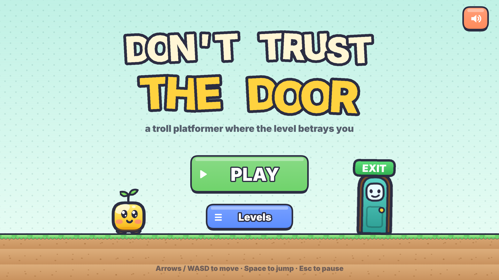
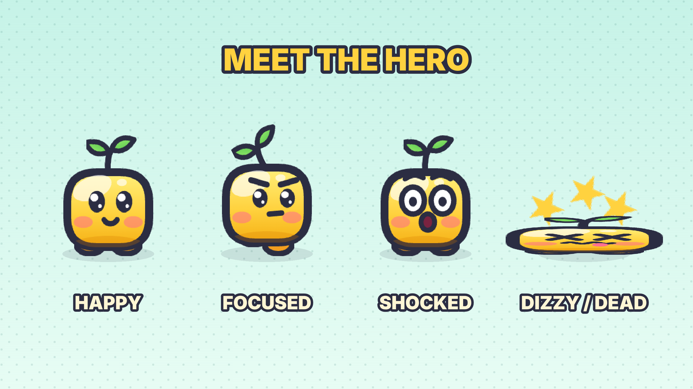

# Don't Trust the Door

A troll platformer where the level betrays you. Original web game by AtelierPro Aramyan Games.

Short, simple-looking levels where the floor collapses, spikes pop out, the EXIT door grows legs and
runs away, ceilings fall and "safe" coins bite. Every trap is surprising the first time and fair the
second time. Death restarts instantly; the death counter is always on screen.

**Play:** https://rafikaramyan1987-ux.github.io/Dont-Trust-The-Door/ (phone: play in landscape)

<p>


</p>

This is a **vertical slice**: 10 levels, title screen, level select, pause, restart, mute, saving.
Everything (art, sound, music) is generated in code; there are no external assets.

## Run it

```bash
npm install
npm run dev        # http://localhost:5173  (also reachable from a phone on the same Wi-Fi)
npm run build      # production build in dist/ (static files, ~1.5 MB)
npm run preview    # serve dist/
```

Controls: **← → / A D** move · **Space / ↑ / W** jump (hold = higher) · **Esc / P** pause · **R** restart ·
**M** mute. On touch screens, large semi-transparent buttons appear in the side margins, outside the level.

Handy URL parameters: `?level=4` jumps straight to a level, `?touch=1` forces the touch controls on
desktop, `?unlock` (on the level-select screen) unlocks every level.

## Tech

- Vite + TypeScript + Phaser 3.90 (Arcade physics), WebGL with Canvas fallback.
- One level = 32×18 tiles of 40 px (1280×720 world, 16:9). The camera zooms to fit any screen; on
  touch devices side "pillars" are reserved for the buttons so they never cover the action.
  Portrait phones get a "rotate your phone" message.
- **Fixed 60 Hz simulation.** The game advances in deterministic 1/60 s ticks (Arcade's world is
  stepped manually), independent of the display frame rate. That is what makes recorded bot
  replays exact and the slow-motion effect free of physics side effects.
- Platformer feel: coyote time (6 ticks), jump buffering (7 ticks), variable jump height (release
  to cut the jump), quick acceleration/deceleration (no ice), stronger gravity when falling.
- Juice: squash & stretch, dust puffs, idle blink, expressions (happy / focused / shocked / dizzy),
  pancake death with stars, screen shake, brief slow motion when a trap fires, particle burst on
  death, confetti "pop" at the real exit, a door with a face that says "hehe" before betraying you.
- Audio: WebAudio synth for all sound effects and an original chiptune loop (`src/audio.ts`).
- Saving: unlocked levels, deaths per level, total deaths and mute state in `localStorage`
  (all access in try/catch – the game keeps working with storage blocked).

```
src/
  main.ts            game config, DPR-aware canvas sizing
  config.ts          tuning constants, world palettes
  art.ts             every texture, drawn with Canvas 2D
  audio.ts           sound effects + music (live and offline rendering)
  input.ts layout.ts keyboard/touch input, responsive camera layout
  save.ts            persistence
  game/Hero.ts       hero rig (expressions, squash & stretch)
  game/Door.ts       the EXIT door character
  scenes/            Boot, Title, Select, Game (simulation, traps, HUD, overlays)
  levels/*.json      ← the levels
  testHooks.ts       test-only API (active with ?test)
tests/               level validator, bot replays, self-test
tools/               screenshot + trailer capture
```

## Adding levels (data files)

Each level is one JSON file in [`src/levels/`](src/levels). Files are loaded automatically and
ordered by name (`11-my-level.json` becomes level 11). No code changes are needed.

```jsonc
{
  "id": 2,
  "name": "Solid Ground",
  "world": 0,                       // colour palette: 0 meadow, 1 candy, 2 twilight, 3 sunset
  "winMessage": "The floor lied.",  // shown on the level-complete card
  "deathQuips": ["The floor lied.", "Still lying."],   // optional, shown on death
  "hints": [{ "x": 13, "y": 10, "text": "jump it?", "afterDeaths": 2 }],
  "map": [                          // 18 rows × 32 characters
    "................................",
    "...",
    ".P...........................D..",
    "############aaa#################",
    "############^^^#################",
    "################################"
  ],
  "groups": { "a": { "tile": "#", "cover": [[12,16],[13,16],[14,16]] } },
  "triggers": [ { "when": { "touch": "a" }, "do": [ { "fall": "a", "shake": 3 } ] } ]
}
```

**Map legend**

| char | meaning | char | meaning |
|---|---|---|---|
| `.` | empty | `#` | solid block |
| `^ v < >` | spikes (pointing up/down/left/right) | `=` | jump pad |
| `o` | coin (genuine) | `P` | player start |
| `D` | the real EXIT (bottom tile; hangs upside-down if attached to a ceiling) | `F` | fake EXIT (bites) |
| `a`–`z` (not `o`/`v`) | tile of a named **group** that triggers can control | | |

**Groups** (`"groups": { "a": {...} }`): `tile` (what the group is made of: `#`, a spike char, `=`,
`o`), `hidden` (starts retracted/invisible, e.g. pop-up spikes), `fake` (a wall you can walk through),
`trapCoin` (coin turns into a spiky ball), `look` (`cracked` / `bolted` visual hints), `cover`
(extra tiles drawn as part of the group – e.g. hides a spike pit under a collapsing floor).

**Triggers** fire once per attempt. `when`: `zone: [x, y, w, h]` (tiles; optional `airborne` /
`grounded`), `touch: "a"` (touching a group), `start: true`, or `after: "<trigger id>"`; optional
`delay` in ticks (60 = 1 s). **Actions** (`do`):

| action | effect |
|---|---|
| `{ "fall": "a", "shake": 6 }` | group shakes, then drops away (no longer solid) |
| `{ "pop": "a" }` / `{ "retract": "a" }` | hidden spikes shoot out / go back |
| `{ "move": "a", "by": [0, 4], "ticks": 14, "deadly": true, "returnAfter": 50, "returnTicks": 40 }` | slide a group; `deadly` crushes while moving |
| `{ "chase": "w", "vel": [3.4, 0], "untilX": 25 }` | move a group continuously (px per tick) |
| `{ "doorRun": [[26,14],[28,12]], "speed": 7, "hehe": 28 }` | the EXIT says "hehe", grows legs and runs along tile waypoints |
| `{ "doorHehe": 40 }` | the door just giggles |
| `{ "gravity": "flip" }` / `"normal"` | flip gravity |
| `{ "say": "text", "at": "hero" \| "door" \| [x, y], "ticks": 60 }` | speech bubble |
| `{ "shake": 4, "ticks": 30 }`, `{ "slowmo": 20 }`, `{ "show": "a" }`, `{ "hide": "a" }`, `{ "scare": true }` | effects |

Every trap action automatically adds the juice: shocked face, a short slow motion and a sound.

`npm run test:levels` validates all level files (size, legend, group and trigger references).
To make a new level part of the self-test, add a `win` plan (and `traps`) to
[`tests/plans.mjs`](tests/plans.mjs) and run `npm run record` – it records frame-exact replays.

## Self-test

```bash
npm test     # validate levels → build → headless self-test (needs Playwright's Chromium)
```

- `tests/plans.mjs` – condition-based scripts ("hold → until x ≥ 440, then jump 16 ticks…"), used
  only to *author* replays.
- `tests/replays/level-XX.json` – the recorded, frame-exact inputs: one `win` run per level and
  one or more `traps` runs per level.
- `tests/run-selftest.mjs` – replays everything against the production build in headless Chromium.

### Results (latest run)

**49/49 checks passed** (2026-11-12, `npm test`).

| | check | result |
|---|---|---|
| ✅ | bot completes level 1 in real time | won, 5.0 s, 60 fps, p95 frame 19.6 ms |
| ✅ | bot completes level 2 in real time | won, 4.2 s, 60 fps, p95 frame 18.6 ms |
| ✅ | bot completes level 3 in real time | won, 8.7 s, 60 fps, p95 frame 18.1 ms |
| ✅ | bot completes level 4 in real time | won, 4.3 s, 60 fps, p95 frame 17.9 ms |
| ✅ | bot completes level 5 in real time | won, 8.3 s, 60 fps, p95 frame 18.4 ms |
| ✅ | bot completes level 6 in real time | won, 5.6 s, 60 fps, p95 frame 18.5 ms |
| ✅ | bot completes level 7 in real time | won, 0.7 s, 60 fps, p95 frame 18.5 ms |
| ✅ | bot completes level 8 in real time | won, 5.2 s, 60 fps, p95 frame 19.6 ms |
| ✅ | bot completes level 9 in real time | won, 4.1 s, 60 fps, p95 frame 19.3 ms |
| ✅ | bot completes level 10 in real time | won, 5.0 s, 60 fps, p95 frame 18.6 ms |
| ✅ | stable ~60 fps during the real-time bot run | avg 60.0 fps, worst level avg 59.9 fps (480×270, software WebGL) |
| ✅ | progress saved: all 10 levels completed/unlocked | {"unlocked":10,"completed":10} |
| ✅ | trap kills: level 1 – the gap (tutorial) | cause=pit at tick 221 |
| ✅ | deterministic replay wins level 1 | 301 ticks = 5.0 s |
| ✅ | trap kills: level 2 – floor collapses into spikes | cause=spikes at tick 103 |
| ✅ | deterministic replay wins level 2 | 228 ticks = 3.8 s |
| ✅ | trap kills: level 3 – chasing the door into the gap | cause=spikes at tick 450 |
| ✅ | deterministic replay wins level 3 | 484 ticks = 8.1 s |
| ✅ | trap kills: level 4 – spikes pop where a normal jump lands | cause=spikes at tick 152 |
| ✅ | trap kills: level 4 – second patch: the tiny hop lands on new spikes | cause=spikes at tick 172 |
| ✅ | deterministic replay wins level 4 | 224 ticks = 3.7 s |
| ✅ | trap kills: level 5 – the ceiling falls | cause=crush at tick 189 |
| ✅ | deterministic replay wins level 5 | 443 ticks = 7.4 s |
| ✅ | trap kills: level 6 – jump pad into ceiling spikes | cause=spikes at tick 89 |
| ✅ | deterministic replay wins level 6 | 307 ticks = 5.1 s |
| ✅ | trap kills: level 7 – the fake EXIT bites | cause=fakedoor at tick 199 |
| ✅ | deterministic replay wins level 7 | 24 ticks = 0.4 s |
| ✅ | trap kills: level 8 – gravity flips into ceiling spikes | cause=spikes at tick 147 |
| ✅ | deterministic replay wins level 8 | 270 ticks = 4.5 s |
| ✅ | trap kills: level 9 – the coin on the floor bites | cause=coin at tick 72 |
| ✅ | trap kills: level 9 – coin arc over the pit | cause=coin at tick 118 |
| ✅ | deterministic replay wins level 9 | 224 ticks = 3.7 s |
| ✅ | trap kills: level 10 – the floor drops | cause=spikes at tick 135 |
| ✅ | trap kills: level 10 – the spike wall catches you | cause=spikes at tick 134 |
| ✅ | deterministic replay wins level 10 | 251 ticks = 4.2 s |
| ✅ | death counter equals number of deaths | 13 == 13 |
| ✅ | HUD death counter shows the total | HUD "13" |
| ✅ | save survives a page reload | totalDeaths=13 |
| ✅ | blocked localStorage is handled (try/catch) | ok |
| ✅ | restart after death is instant (< 0.3 s) | 266 ms |
| ✅ | CPU time per frame at 1280×720 is far below the 16.7 ms budget | 0.53 ms/frame |
| ✅ | level rebuild on restart is cheap | 1.64 ms (restart delay itself is 16 ticks = 267 ms) |
| ✅ | desktop 1280×720: level fills the screen, no touch buttons | {"zoom":1,"touch":false} |
| ✅ | phone landscape 844×390: buttons visible, ≥44 px, outside the level area | level spans 114–730 css px; buttons left 52×99@29, right 52×99@85, jump 106×117@787 |
| ✅ | touch: holding ▶ moves the hero right | x 60 → 95, vx 300 |
| ✅ | touch: second finger on jump makes the hero jump (multi-touch) | min y 531 (ground 586) |
| ✅ | phone portrait 390×844 shows "rotate your phone" | {"display":"flex","text":"Rotate your phone"} |
| ✅ | no console errors |  |
| ✅ | production build under 10 MB | 1.49 MB |

Notes: headless Chromium has no GPU – WebGL is rasterised on the CPU by SwiftShader, which caps a
1280×720 canvas at ~12–18 fps no matter what is drawn. The real-time bot run therefore uses a small
window, and the CPU cost of a full 1280×720 frame is measured separately (≈0.6 ms of the 16.7 ms
budget); on a phone the GPU does the rasterising.

## Media

- Screenshots: [`docs/media/screens/`](docs/media/screens) (title, hero expressions, level select,
  the funniest moment of every level, phone/desktop layouts).
- Trailer: [`docs/media/trailer-9x16.mp4`](docs/media/trailer-9x16.mp4) – 20 s, 1080×1920, 30 fps,
  with sound. Re-generate with `npm run build && npm run media` (needs ffmpeg and Python Pillow).

All captures come from the real game driven by the recorded replays.

## Deployment

`.github/workflows/pages.yml` builds on every push to `main` (and the slice branch) and publishes
`dist/` to the `gh-pages` branch. If the site is not live yet: **Settings → Pages → Build and
deployment → Source: Deploy from a branch → `gh-pages` / `(root)`**.
