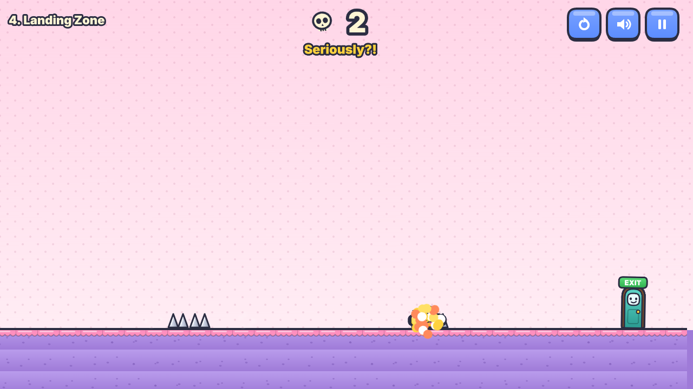
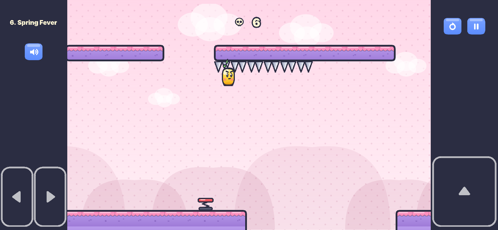
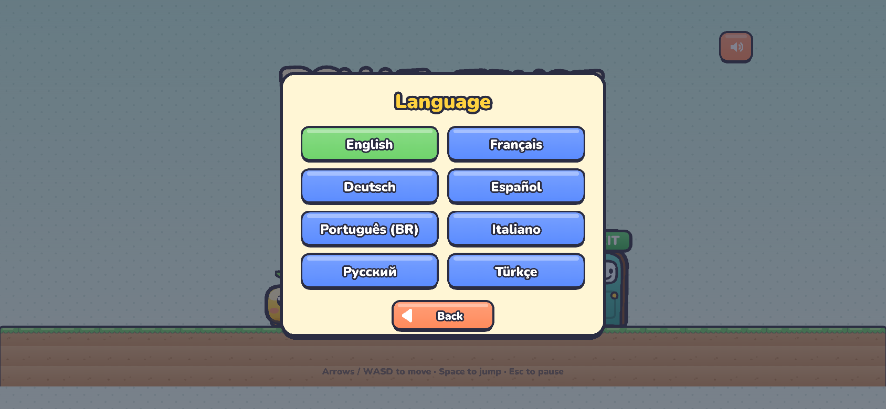
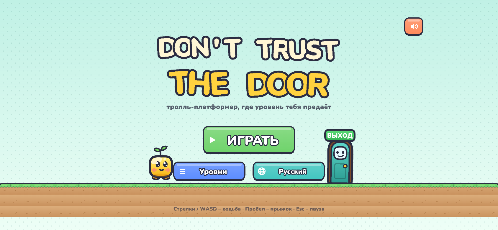

# Don't Trust the Door

A troll platformer where the level betrays you. Original web game by AtelierPro Aramyan Games.

**20 long levels, 20 themes, 241 traps – every one a different idea**: the floor, coins, springs,
the cave ceiling, your own controls, gravity, the EXIT door itself, the camera, things that chase
you, the moving platforms – and in the new levels buttons that lie, crates you push and climb, water
you swim in, keys and locks, lasers, shrinking and growing, wind, ghosts, fireworks and signs that lie. No trap type, mechanic or map section appears twice. Every trap is surprising the first time
and solvable the second: you always see the hero, each trap has one machine-checked solution, and a
checkpoint flag follows every three traps (from level 11 also never more than 200 tiles apart). Death
restarts instantly; the death counter is always on screen. Playable in **8 languages**. Also built for
the game portals Playgama, GamePix, Y8 and CrazyGames (see [Portal builds](#portal-builds)).

Levels 11–20 follow a length table (each level 15% longer than the one before, with one more trap);
levels **11–20 are done**, levels 21–30 are still to come (the level select already shows all 30).

**Play:** https://rafikaramyan1987-ux.github.io/Dont-Trust-The-Door/ (phone: play in landscape)

<p>


</p>

## How to play

Reach the EXIT door – the real one. **← → / A D** move · **Space / ↑ / W** jump (hold = higher) ·
**Esc / P** pause · **R** restart the level · **M** mute. On phones (landscape) big buttons sit in the
side margins outside the level; the orange **restart** button is at the top right. Holding ▲ gives the
same full jump as the jump key.

- **Checkpoints:** a flag after every 3 traps – a death never costs more than 3 traps of progress.
  The restart button always goes back to the very start.
- **One hint per level (light bulb):** you choose when to use it. It explains the next trap ahead and
  highlights exactly its dangerous tiles, then greys out until you finish the level or start it again
  from level select. Apart from that, the only text in the levels is the move/jump instruction at
  the start of level 1 (shown once); death quips are jokes, not hints.
- **The camera never hides you:** when a camera trap looks elsewhere, a yellow arrow at the screen
  edge shows where the hero is.

## Languages

English, Français, Deutsch, Español, Português (Brasil), Italiano, Русский, Türkçe. The game starts in
the browser's language when it is one of these (otherwise English); the 🌐 button on the title screen
and in the pause menu switches it and the choice is saved. Every text – menus, buttons, level names,
hints, death quips, win messages, the fake "level clear" card, the tutorial, the EXIT sign, the
"rotate your phone" screen – lives in one file per language: [`src/i18n/<code>.json`](src/i18n).
Levels and code only use text keys. The bundled font (Nunito, SIL Open Font License) has Latin,
Latin-extended (ç ğ ı ş ö ü, accents) and Cyrillic glyphs; button texts shrink to fit and the hint box
wraps, which the self-test checks for every language at 640×360.

<p>


</p>

## The 241 traps

Each line: the trap, its type key (unique across the game) and its hint – which describes exactly
the solution the bot uses to pass it.

### 1. Hello, Floor — The floor is not what it seems

236 tiles wide (was 118, ×2.00) · 8 traps · checkpoint after every 3 traps · bot win 33.2 s

1. **The floor sinks into the abyss** (`sinking-floor`) – The cracked floor ahead slowly sinks into the abyss – step on it and jump off to the right straight away.
2. **Two fake floor tiles over spikes** (`fake-floor`) – Two tiles in the middle of the plateau are fake – jump over them.
3. **Cracked floor crumbles if you stop on it** (`collapsing-floor`) – The cracked floor in the dip crumbles shortly after you step on it – keep walking across.
   - 🚩 *checkpoint*
4. **The conveyor belt drags you into the pit** (`conveyor-floor`) – After the little pit the floor is a conveyor belt that drags you back into it – keep running right.
5. **The hatch breaks under a hard landing** (`hard-landing-hatch`) – The bolted hatch after the spike breaks if you land on it hard – clear the spike with a tiny tap jump.
6. **An invisible bridge over the wide pit** (`invisible-floor`) – An invisible bridge crosses the wide pit, but it starts 2 tiles out – jump from the edge, then walk.
   - 🚩 *checkpoint*
7. **Slippery ice slides you into the pit** (`ice-floor`) – The blue floor is ice: you cannot stop on it – keep running and jump at its very end.
8. **The bridge crumbles behind you** (`crumbling-bridge`) – The long bridge crumbles plank by plank right after you step on it – keep running across.

### 2. Greedy Little Blob — "Safe" coins are traps

284 tiles wide (was 142, ×2.00) · 8 traps · checkpoint after every 3 traps · bot win 39.4 s

1. **A coin in the trough bites** (`biting-coin`) – The coin lying in the trough has teeth – jump over the whole trough.
2. **The coin arc over the pit bites** (`coin-arc`) – The coins above the pit bite – cross it with a small hop that stays under them.
3. **Grabbing the lone coin makes spikes shoot up** (`cursed-coin`) – Do not jump for the lone coin above the stage – walk underneath it.
   - 🚩 *checkpoint*
4. **The coin trail leads into a pit** (`coin-trail`) – The coin trail from the high walkway leads into the pit – stay low and jump the pit from the ground.
5. **Only the top of the coin wall is real** (`coin-wall`) – The lower half of the coin wall bites – jump so you fly through its top half.
6. **Spiky coins rain from the sky** (`coin-rain`) – Coins rain down in three columns – wait until a shower hits the ground, then dash through.
   - 🚩 *checkpoint*
7. **A coin balloons into a giant spiked coin** (`giant-coin`) – The coin in the low corridor puffs up into a giant spiked coin – stop, wait until it shrinks, then go.
8. **The coin explodes into spikes** (`coin-bomb`) – The coin in the tunnel explodes into spikes a moment after you grab it – keep running.

### 3. Spring Fever — Springs

275 tiles wide (was 135, ×2.04) · 8 traps · checkpoint after every 3 traps · bot win 40 s

1. **The spring shoots you into ceiling spikes** (`spring-ceiling`) – The spring shoots you at spikes – hold LEFT while flying to go up through the gap.
2. **The first spring is a dud** (`dud-spring`) – The first (rusty) spring over the void is a dud – jump past it onto the red one.
3. **A spring pops out of the floor** (`hidden-spring`) – A spring pops out of the floor under the spiked bar – jump over that spot.
   - 🚩 *checkpoint*
4. **A sideways spring flings you into spikes** (`sideways-spring`) – The blue spring flings you sideways into spikes – jump over it.
5. **A spring lobs a spiked ball at you** (`catapult-spring`) – Stepping on the stone plate makes the spring lob a spiked ball at you – keep running under it.
6. **The rubber floor bounces you into spikes** (`rubber-floor`) – The springy floor only bounces when you land on it hard – walk on it and jump only under the gap in the ceiling.
   - 🚩 *checkpoint*
7. **The spring bounces higher every time** (`escalating-spring`) – The spring in the well bounces you higher each time – jump off to the right on the second bounce.
8. **The diagonal spring flings you too far** (`overshoot-spring`) – The diagonal spring throws you way too far – let go of the keys after it launches you to land on the small island.

### 4. Heavy Ceiling — The ceiling is out to get you

260 tiles wide (was 129, ×2.02) · 8 traps · checkpoint after every 3 traps · bot win 39.1 s

1. **Ceiling spikes drop on you** (`dropping-ceiling-spikes`) – The spikes under the low rock drop when you come near – step back, let them fall and rise, then go.
2. **The cracked slab crashes down** (`crusher-slab`) – The cracked slab crashes down a moment after you step under it – sprint through without stopping.
3. **Bonking the brick drops spiked rocks** (`loose-brick`) – Do not jump into the bolted brick – bonking it drops spiked rocks on you. Just walk under it.
   - 🚩 *checkpoint*
4. **A stone block slams down in rhythm** (`thwomp`) – The stone block slams down in a steady rhythm – wait until it lifts, then run under it.
5. **Stalactites fall one after another** (`domino-stalactites`) – Once you pass the first stalactite they all fall one after another behind you – keep running.
6. **The hole in the ceiling is a trap** (`fake-ceiling`) – The open hole in the low ceiling hides spikes – the way up is the cracked part that looks solid.
   - 🚩 *checkpoint*
7. **The whole roof slab crashes down** (`safe-notch`) – The whole roof slab crashes down – drop into the slot in the floor and wait there until it lifts.
8. **The spiked ceiling comes down** (`descending-ceiling`) – The spiked ceiling lowers as soon as you enter – hurry to the pit and jump it while there is still room.

### 5. Left Is Right — The controls betray you

299 tiles wide (was 149, ×2.01) · 8 traps · checkpoint after every 3 traps · bot win 42 s

1. **Left and right swap** (`controls-swap`) – On the purple floor left and right are swapped – hold LEFT to go right, and LEFT+jump over its pit.
2. **The jump stops working** (`broken-jump`) – Jump does not work on the 2 grey tiles before the pit – take off just before the grey tiles.
3. **Super jumps hit the spiked roof** (`super-jump`) – On the orange floor every jump is super strong – cross the pit with a short tap so you stay under the spiked roof.
   - 🚩 *checkpoint*
4. **You get the hiccups** (`hiccup-jump`) – On the green floor you hop by yourself every moment – wait in each gap for a hop, then run under the next spikes.
5. **Your buttons lag behind** (`input-lag`) – On the teal floor every button reacts late – press jump about two tiles before the pit.
6. **Your controls freeze** (`frozen-controls`) – The pale strip freezes your controls for a second and you keep sliding – step onto it slowly.
   - 🚩 *checkpoint*
7. **Turbo speed makes you overshoot** (`turbo-speed`) – On the red floor you run twice as fast – make a tiny hop onto the island, then a full jump from its edge.
8. **You cannot stop running** (`auto-run`) – On the yellow floor you cannot stop running – jump the pit, the block and the wide pit right at their edges.

### 6. Upside Downer — Gravity

243 tiles wide (was 121, ×2.01) · 8 traps · checkpoint after every 3 traps · bot win 32.6 s

1. **Gravity flips – drifting lands you in ceiling spikes** (`gravity-flip`) – Gravity suddenly flips and you fall up – let go of the keys so you land before the ceiling spikes, then jump over them.
2. **Gravity flips back above a spike field** (`gravity-flip-back`) – At the end of the ceiling walk gravity flips back above spikes – keep holding RIGHT while you fall.
3. **Floaty gravity – a jump hits the spikes** (`low-gravity`) – Gravity is weak at the end of the top step – do not jump (you would hit the spikes); just walk off the edge and float across.
   - 🚩 *checkpoint*
4. **Heavy gravity – you fall into tiny cracks** (`heavy-gravity`) – On the dark floor you are so heavy you fall into the thin cracks – hop over each crack.
5. **The ground falls up into the sky** (`ground-falls-up`) – A chunk of the ground ahead falls up into the sky when you come near – jump over the hole it leaves.
6. **A bubble makes you float up into spikes** (`floating-bubble`) – Inside the bubble over the pit you float upward – do not jump or stop, walk straight through it.
   - 🚩 *checkpoint*
7. **Jump flips gravity instead** (`flip-on-jump`) – On the blue strip jump flips gravity – flip up before the pit, then flip down right after it, before the ceiling spikes.
8. **Gravity flips back and forth** (`gravity-pulse`) – Gravity flips up and down every moment – keep running: cross the floor spikes while you are on the ceiling.

### 7. Too Many Doors — The EXIT keeps changing its mind

250 tiles wide (was 125, ×2.00) · 8 traps · checkpoint after every 3 traps · bot win 37.1 s

1. **A fake EXIT bites** (`fake-exit`) – That EXIT under the steps is fake and bites – climb the steps and go over the wall.
2. **A door kicks you back into the pit** (`kick-door`) – The door after the pit kicks you back into it – jump over the door.
3. **A door licks you with a spiked tongue** (`door-tongue`) – The door shoots out a spiked tongue when you come near – stop, let it lick and pull back, then jump over the door.
   - 🚩 *checkpoint*
4. **A portal door throws you at a pit** (`portal-door`) – The door in the wall is a portal and you come out just as fast, right before a pit – walk in slowly.
5. **The EXIT grows legs and runs away** (`runaway-exit`) – The EXIT on the ledge runs away – do not walk off after it: jump from the very edge of the ledge.
6. **Biting doors slam open and shut** (`slamming-doors`) – The three doors snap open and shut in turn – go through each one right after it opens.
   - 🚩 *checkpoint*
7. **The EXIT swaps itself for a fake** (`exit-swap`) – The EXIT ahead swaps itself for a biting fake when you come near – jump over the fake one.
8. **The real EXIT hides inside the wall** (`hidden-exit`) – The wall top is spiked – step down from the stairs and walk into the wall: the real EXIT hides inside it.

### 8. Screen Lies — The camera lies

406 tiles wide (was 203, ×2.00) · 10 traps · checkpoint after every 3 traps · bot win 54.3 s

1. **The camera stops following you** (`camera-freeze`) – The camera stops following you – keep going and watch the yellow arrow: jump three pits, 7, 14 and 19 tiles after the start of the frozen stretch.
2. **The camera zooms in – tunnel vision** (`tunnel-vision`) – The camera zooms right in – go slowly: a pit, a spiked block (jump over it), another pit and a single spike follow.
3. **The screen turns upside down** (`screen-flip`) – The screen turns upside down – your keys still work normally: jump the pit, walk under the spiked bar without jumping, jump the wide pit.
   - 🚩 *checkpoint*
4. **A fake "level clear" screen** (`fake-victory`) – The "level clear" card is fake – do not stop under it: a spiked ball drops right there. Keep running and jump the pit.
5. **The lights go out** (`blackout`) – The lights go out and you only see around you – walk slowly: a pit, two spikes, a wide pit, a block and a last pit.
6. **A smudge on the screen hides the way** (`screen-smudge`) – A smudge on the screen hides what is ahead – jump onto the block, then over the gap to the next block, then over a pit.
   - 🚩 *checkpoint*
7. **The camera looks the wrong way** (`backward-camera`) – The camera looks behind you, so things ahead pop up late – a spike, a pit, a block with a spike after it, then a wide pit.
8. **The lights only flash** (`strobe-lights`) – It is dark except for short flashes – a pit, a block, a wide pit, a spike before a spiked bar (hop it low), then a pit.
9. **The screen rocks like a ship** (`seasick-tilt`) – The screen rocks like a ship and the steps look tilted – they are level: jump up two steps, down one, then across.
   - 🚩 *checkpoint*
10. **The camera follows a fake you** (`decoy-hero`) – A fake you runs back and the camera follows it – follow the yellow arrow: the real you jumps a pit, a wide pit, a block and a wide pit.

### 9. Run! — Something is always chasing you

429 tiles wide (was 214, ×2.00) · 10 traps · checkpoint after every 3 traps · bot win 59.2 s

1. **A spiked ball rolls after you** (`rolling-ball`) – A spiked ball rolls after you, faster than you – keep running and jump the ditch: the ball falls into it.
2. **A turret shoots spiked balls** (`spike-turret`) – The turret at the end fires spiked balls along the floor – jump over each ball as it comes, then hop onto the turret.
3. **A spike wall chases you** (`chasing-wall`) – A spike wall chases you, only a little slower than you – never stop: hop the bump, jump the pit, jump the block.
   - 🚩 *checkpoint*
4. **A spiked fish leaps out of the pit** (`spiked-fish`) – A spiked fish leaps out of the pit as you come near – wait at the edge until it drops back, then jump.
5. **A spiked bird dives at you** (`homing-bird`) – A spiked bird hunts you, faster than you can run – hide in the low tunnel ahead: it crashes into the roof.
6. **A floor of spikes rises** (`rising-flood`) – A floor of spikes rises out of the pit – climb the ledges quickly without waiting.
   - 🚩 *checkpoint*
7. **A frog copies your jumps** (`copycat-frog`) – The spiked frog jumps whenever you jump – do a small hop when it is about 4 tiles away and run under it while it is in the air.
8. **A storm cloud strikes where you stand** (`storm-cloud`) – A storm cloud follows you and strikes where you stand – only stop under the stone roofs, and pass the spikes when they are down.
9. **The floor is eaten away behind you** (`floor-eater`) – Something eats the thin bridge behind you faster than you can run – get up on the stone pillars and hop from pillar to pillar.
   - 🚩 *checkpoint*
10. **Your shadow replays your path** (`shadow-clone`) – A shadow of you follows your exact path a moment later – touching it kills: never stop and never go back.

### 10. The Grand Betrayal — Moving platforms betray you

402 tiles wide (was 201, ×2.00) · 10 traps · checkpoint after every 3 traps · bot win 61.6 s

1. **The platform dodges your jump** (`shy-platform`) – The platform slides two tiles away when you jump at it – aim two tiles further than it is.
2. **The platforms blink away** (`blinking-platform`) – The two platforms blink out every few seconds – start hopping right after they come back.
3. **The platform splits under you** (`splitting-platform`) – The left half of the platform drops away when you land on it – jump from the very edge to land on its right half.
   - 🚩 *checkpoint*
4. **The elevator rises into ceiling spikes** (`elevator-spikes`) – The elevator goes all the way up into the spikes – jump right onto the ledge on the way up.
5. **The loyal platform cannot keep up** (`loyal-platform`) – The platform follows you across the pit, but slowly – walk in short steps and stay above it.
6. **The ferris wheel dips into spikes** (`ferris-wheel`) – Step onto a wheel platform as it comes up past the left island, ride it over the top and step off onto the right island before it dips into the spikes.
   - 🚩 *checkpoint*
7. **The shuttle dives into the void** (`shuttle-dive`) – The moving platform dives halfway across – jump to the far island before it does.
8. **The platform flips its spikes up** (`flip-platform`) – The platform turns over every few seconds and its spikes come up top – cross right after it turns back.
9. **The pulley sinks you into spikes** (`pulley-platforms`) – The two platforms hang on a pulley: yours sinks while the other rises – jump across as soon as it is a bit higher, then straight on to the high island.
   - 🚩 *checkpoint*
10. **The platform teleports away under you** (`teleporting-platform`) – The platform blinks out and reappears 4 tiles further – stand on it and jump forward the moment it blinks, then again.
### 11. Push the Button — Buttons and switches do something other than they promise

462 tiles (table 462) · 11 traps · 3 checkpoints · bot win 70.4 s

1. **The button drops the floor under itself** (`button-trapdoor`) – The button opens the gate, then the floor under the button drops away – step on it and keep walking straight through.
2. **The bridge builds itself slower than you run** (`slow-bridge`) – The button builds the bridge one plank at a time, slower than you run – wait on the button until it reaches the far side.
3. **The button drops the crusher when you get there** (`delayed-crusher`) – The button opens the gate, then drops the cracked crusher in the corridor a moment later – wait on the button until it has crashed down, then hop over it.
   - 🚩 *checkpoint*
4. **Green is the dangerous colour** (`wrong-colour`) – The green button drops the ceiling spikes on you – jump over it; the red button lowers the bridge.
5. **The bridge button pulls the bridge away** (`retract-button`) – The button in front of the bridge makes the bridge vanish – hop over the button onto the bridge.
6. **The ceiling switch opens the hatch you stand on** (`ceiling-switch`) – Bonking the ceiling switch opens the wall, and the cracked hatch under its left half – bonk it standing on the solid floor under its right half.
   - 🚩 *checkpoint*
7. **The lift lands on the button** (`call-button`) – The button calls the lift, which drops spikes first onto the button – step back off it, wait until it lands, hop on and ride it up over the wall.
8. **The button turns the belt round** (`reverse-belt`) – The button turns the belts round toward the spike pit and opens the gate – keep hopping to the gate: the belt cannot push you while you are in the air.
9. **The drawbridge falls on you** (`heavy-gate`) – The button drops the drawbridge forward across the pit, onto the edge in front of it – stay on the button until it has landed, then walk over it.
   - 🚩 *checkpoint*
10. **The wall button opens a pit instead** (`fake-wall-button`) – Do not press the button: it opens a pit in front of the wall. The wall is fake – hop over the button and walk straight through it.
11. **The bars close again before you get there** (`exit-bars`) – The button opens the bars in front of the EXIT, but they close again after a second – go up the steps without stopping.

### 12. Crate Expectations — Crates you push, climb and trust

532 tiles (table 531) · 12 traps · 3 checkpoints · bot win 106.7 s

1. **A crate falls on its shadow** (`crate-shadow`) – A crate drops onto the dark spot on the floor – wait until it lands, push it to the wall and climb up on it.
2. **The top crate bites** (`crate-mimic`) – The cracked crate on top of the stack bites – do not land on it: jump over the whole stack from the ledge.
3. **One push too many and the crate is gone** (`crate-plate`) – Push the crate onto the red plate and stop: it holds the bars open. One push more and it drops into the pit.
   - 🚩 *checkpoint*
4. **Pushing the crate brings the stack down** (`crate-avalanche`) – Do not push the crate on the floor: the shelf above gives way and the stack falls on you. Hop over it.
5. **The crate on the belt rams you** (`crate-belt-ram`) – A crate drops onto the belt and rides it at you, too heavy to push back – jump over it as it comes.
6. **The chute drops crates into the gap** (`crate-chute`) – The chute drops a crate through the gap every couple of seconds – wait for one to fall past, then jump at once.
   - 🚩 *checkpoint*
7. **A turret guards the low tunnel** (`crate-shield`) – A turret fires down the low tunnel, too low to jump in – push the crate ahead of you as a shield, then climb up on it.
8. **The first step shoves the stairs away** (`crate-ice-stairs`) – Stepping on the small cracked crate shoves both crates across the ice into the gap – jump straight onto the big crate.
9. **The bridge holds you or the crate, not both** (`crate-heavy-bridge`) – The cracked ice bridge breaks under you and the crate together – push the crate onto it, step back and let it slide across alone.
   - 🚩 *checkpoint*
10. **The spring shoots you into the spikes** (`crate-pad-damper`) – The spring launches you into the ceiling spikes – push the crate onto it and climb up on the crate instead.
11. **The magnet lifts the crate into its spikes** (`crate-magnet`) – The magnet pulls the crate up to its spikes – jump on as it rises and hop off onto the ledge before the top.
12. **The crate in the shaft is cardboard** (`cardboard-crate`) – The crate at the bottom of the shaft is cardboard over spikes – push the real crate down the shaft first, then drop onto it.

### 13. The Deep End — Water betrays you

614 tiles (table 611) · 13 traps · 4 checkpoints

1. **The tunnel floods behind you** (`flood-tunnel`) – The low tunnel floods as soon as you are inside – do not turn back: swim on to the end and straight up the shaft before your air runs out.
2. **The undertow drags you into the grate** (`undertow`) – Near the bottom of the pool a current drags you into the spiked grate – keep stroking (jump) and stay at the surface.
3. **The pool freezes over** (`freezing-pool`) – The pool freezes over a moment after you jump in – swim under the wall at once and come up through the hole at the far end.
   - 🚩 *checkpoint*
4. **The bubble stream by the wall lifts you into spikes** (`bubble-lift`) – Both bubble streams lift you, but the one near the wall carries you into the spikes under the ledge – take the first one and step off onto the ledge.
5. **The dam bursts and the flood washes you back** (`dam-break`) – When you reach the sluice gate it creaks and bursts, and a flood washes everything back into the spike pit – run back up onto the little ledge and wait until the water is gone.
6. **The raft drifts over the falls** (`drifting-raft`) – The raft drifts all the way to the edge of the falls – jump up onto the ledge as it passes under it.
   - 🚩 *checkpoint*
7. **The pool is a whirlpool** (`whirlpool`) – The pool is a whirlpool: the water drags you to the spiked drain in the middle – do not swim, hop across on the two rocks.
8. **The waterfall knocks you into the pit** (`waterfall-pause`) – The waterfall knocks anyone jumping through it down into the spikes – it pauses every few seconds: jump across right after it stops.
9. **The water is too heavy to swim in** (`heavy-water`) – This dark water is too heavy to swim in: you sink at once onto the spikes – jump up onto the ledge above it instead.
   - 🚩 *checkpoint*
10. **The first air pocket is water** (`fake-air-pocket`) – The bright pocket halfway along the flooded tunnel is water, not air – keep going and breathe in the second pocket.
11. **The pool is electrified** (`electric-water`) – Every few seconds the pool is electrified for a moment – wait for a zap, then swim across at once.
12. **A spiked buoy drifts at you** (`spiked-buoy`) – A spiked buoy drifts along the surface toward you under the rock roof – dive to the bottom and let it pass over you.
   - 🚩 *checkpoint*
13. **A wall of water hangs over the pit** (`water-wall`) – The wall of water over the pit slows you down and you sink in it – jump in and keep stroking until you come out on the far side.

### 14. Lock and Key — Keys and locks betray you

708 tiles (table 703) · 14 traps · 4 checkpoints

1. **The golden plank is the key** (`key-plank`) – The golden plank in the bridge is the key: step on it and you take it and fall – hop over it, then step back onto its edge from the right to pick it up.
2. **The iron key weighs you down** (`iron-key`) – Carrying the iron key your jumps are very low – you cannot hop the spiky wall: drop into the tunnel in front of it and walk under it.
3. **The skeleton key opens the wrong lock too** (`skeleton-key`) – The skeleton key opens every lock – also the padlock on the post that holds the spiked ball over you. Hop over the post without touching it.
   - 🚩 *checkpoint*
4. **The glass key shatters on a hard landing** (`glass-key`) – The glass key breaks if you land hard – no big jumps or drops while you carry it: walk down the steps and hop the spike with a tiny jump.
5. **The first padlock eats your key** (`hungry-lock`) – Both padlocks lower the bridge, but the first one is hungry: it eats your key. Jump over the first padlock and touch the second one at the pit.
6. **The key is chained to its post** (`chained-key`) – The key is chained to the post behind it – run off with it and the chain yanks you back into the pit. Take it back to the post first: the key opens the padlock on its chain.
   - 🚩 *checkpoint*
7. **The ice key melts** (`melting-key`) – The ice key melts a few seconds after you take it – run straight to the padlock at the wide pit without stopping: it lowers the bridge as you pass.
8. **The key is yanked away on a fishing line** (`fishing-key`) – The key hangs on a fishing line and is yanked away from you – from the left it flees over the pit. Go over it on the ledge, drop down on its right and chase it back into the corner at the post.
9. **Taking the silver key drops the gold one** (`key-juggle`) – You carry only one key: taking the silver key on the grate drops your gold key through it. Hop over the silver key, open the gold door first, then come back for the silver one.
   - 🚩 *checkpoint*
10. **A magpie steals the key when you jump** (`magpie-key`) – The magpie steals the key the moment you jump with it. Let it: hop once on the safe ground, follow it to its nest on the block, take the key back, then jump to the door.
11. **A ball rolls up while the rusty lock turns** (`rusty-lock`) – The rusty lock needs you to stay at it for a few seconds, and a spiked ball rolls up behind you meanwhile – jump straight up when it comes, then stay at the lock.
12. **Taking the key drops the bars** (`alarm-key`) – Taking the key sets off the alarm: the bars over the doorway crash down when you go back out. Jump up through the hole in the roof instead.
   - 🚩 *checkpoint*
13. **The jingling key wakes the bat** (`jingle-keys`) – The key jingles when you run with it, and the jingle wakes the spiked bat under the rock – walk slowly (tap the arrow) until you are past it.
14. **The key keeps changing colour** (`chameleon-key`) – The key keeps changing colour, and the gold door only opens while it is gold – wait at the edge until it turns gold, then jump at once.

### 15. Laser Show — Lasers, beams, scanners and light betray you

808 tiles (table 808) · 15 traps · 4 checkpoints

1. **Breaking the sensor line sends a laser wall** (`tripwire-alarm`) – The thin green line at your ankles is an alarm: if you break it a laser wall sweeps back down the hall – hop over the line right after the spike pit.
2. **The switched-off laser switches on when you jump** (`jump-armed-laser`) – The dim laser over the hurdles is not off: it switches on the moment you jump – clear the hurdles and spikes with short, low hops.
3. **The scanner ray sweeps the hall** (`sweep-scanner`) – The scanner ray turns round and its tip on the floor speeds up as it goes – wait until it has swept past the doorway, then follow close behind it (do not jump right behind it: the ray leans back over you).
   - 🚩 *checkpoint*
4. **The gaps in the laser curtains move** (`gap-curtain`) – The gaps at the foot of the three laser curtains start moving up and down as you come – wait until the first gap comes back down to the floor and run straight through all three with the wave.
5. **The mirror turns the laser onto the ledge** (`mirror-ledge`) – The red plate on the open ledge swings the mirror and the laser sweeps the whole ledge – drop down and take the low tunnel under it (hop its two spikes with tiny hops).
6. **An invisible laser crosses the smoke** (`smoke-beam`) – An invisible laser crosses the smoke column: while it is on the smoke glows red – wait on the far side of the spike pit until the smoke turns grey, then run through.
   - 🚩 *checkpoint*
7. **The prism fans out into rays** (`prism-fan`) – When you pass under it the prism charges and fans out into rays down to the floor – stop on the dark spot in its shadow just before the prism and wait until the rays go out.
8. **The laser gates pulse faster and faster** (`rhythm-beams`) – The five laser gates pulse together and the beat gets faster each time – stop in front of every gate, and run through the moment it goes out.
9. **The camera sees you and the laser grid fires** (`camera-cone`) – If the camera's light cone touches you the whole room fills with lasers – move only while it looks the other way and hide under the three stone canopies.
   - 🚩 *checkpoint*
10. **The speed camera zaps you** (`speed-camera`) – The camera on the pole zaps anyone faster than walking pace on the dashed stretch – tap right to creep along it, then take a run-up for the spike pit.
11. **The real laser is the faint one above the hologram** (`hologram-grid`) – The bright laser wall is a flickering hologram – walk straight through it; the faint pink line above it is the real laser, so do not jump over the wall from the stairs.
12. **The dance floor fires lasers** (`dance-floor`) – Every other pair of dance-floor panels glows and then fires a laser up to the ceiling – keep stepping onto the pair that is not glowing, one pair at a time.
   - 🚩 *checkpoint*
13. **Your shadow sinks the solar lift** (`solar-lift`) – The lift only rises while the light reaches its solar panel – stand on its left edge (out of the light beam) and ride it up; standing in the middle casts your shadow on the panel and it sinks into the spikes.
14. **The light bridge has a laser blade** (`blade-bridge`) – The light bridge slides out toward you with a laser blade on its tip – stay back at the edge and only step on once it has docked and the blade is gone.
15. **The cannon fires along the floor** (`charge-cannon`) – The cannon behind you charges up and fires a long beam along the floor – drop into a trench before every shot and run on after it.

### 16. Size Matters — The hero shrinks and grows

935 tiles (table 929) · 16 traps · 5 checkpoints

1. **The mushroom in the low tunnel crushes you** (`tunnel-shroom`) – The red mushroom inside the low tunnel makes you grow and the roof crushes you – climb on top of the tunnel and walk over it.
2. **The blue mushroom shrinks you before the gap** (`shrink-before-gap`) – The blue mushroom under the rock shrinks you, and tiny you cannot jump the spike pit – hop over the mushroom.
3. **Giant you breaks the bridge** (`giant-bridge`) – The red arch makes you giant and the cracked bridge breaks under giant you – jump up into the blue mushroom hanging before it, then cross at normal size.
   - 🚩 *checkpoint*
4. **The air vent blows tiny you into the thorns** (`tiny-updraft`) – Tiny you is light: the air vent blows you up into the thorns – hop up into the red mushroom before it and cross at normal size.
5. **A crystal shrinks you mid-jump** (`shrink-ray`) – The crystal flashes a shrink beam over the pit every few seconds and tiny you falls short – wait for a flash to end, then run and jump at once.
6. **The fairy ring grows you into the bramble** (`fairy-ring`) – Walking into the fairy ring makes you giant and the bramble ahead catches giant you – jump over the ring: it only works on whoever walks into it.
   - 🚩 *checkpoint*
7. **Giant you sinks the lily pads** (`sinking-lilypads`) – Giant you is so heavy the lily pads sink into the thorns – do not step on them: leap over the whole pond from the top of the wall.
8. **Tiny you cannot reach the little door** (`tiny-door-step`) – Do not eat the blue mushroom on the ground: tiny you cannot climb the step and the flytrap snaps you up. Jump up the step at normal size through the floating blue mushroom, then crawl through the little door.
9. **Only giant you can cross the holes** (`grow-to-cross`) – This time the red mushroom is your friend: jump up to it. Giant you walks straight over the little spike holes under the bramble – do not jump there.
   - 🚩 *checkpoint*
10. **The tailwind blows tiny you too far** (`tiny-tailwind`) – Tiny you is light: the tailwind on the ledge blows you over the little island into the spikes – hold LEFT against it and drift slowly off the edge.
11. **Pollen flips your size in the low tunnel** (`pulse-tunnel`) – The pollen arch flips you between tiny and giant every second, and giant you is crushed in the low tunnel – wait in front of it and in each tall chamber until you turn tiny, then run on.
12. **Landing on a puffball shrinks you** (`puffball-field`) – A puffball bursts and shrinks you only when you land on it, and tiny you cannot jump the pit – walk straight across them all, then jump the pit.
   - 🚩 *checkpoint*
13. **The flowers only hold tiny you** (`flower-stepping`) – The flower heads over the thorns sink under anyone bigger than tiny – hop up into the floating blue mushroom first and cross on them tiny.
14. **Giant you snaps the springs** (`spring-snap`) – The red arch makes you giant and giant you is too heavy for the springs: they snap – hop onto the stone and jump straight up onto the cliff instead.
15. **A gust blows tiny you back into the pit** (`tiny-breeze`) – The fan blows in gusts and a gust blows light tiny you back into the spike pit – wait at the slot until a gust stops, then run and jump at once.
   - 🚩 *checkpoint*
16. **The EXIT is tiny** (`tiny-exit`) – The real EXIT is tiny and the thorns over its mouse hole catch anyone bigger – hop up into the floating blue mushroom first, then walk in.

### 17. Blown Away — Wind, fans and air betray you

1078 tiles (table 1068) · 17 traps · 5 checkpoints

1. **The fan blows you back into the pit** (`gap-fan`) – The fan on the far side blows in bursts and pushes you back into the spikes – wait until it stops, then jump across at once.
2. **The updraft flings you into the roof spikes** (`vent-updraft`) – Do not jump over the vent: the updraft would fling you into the roof spikes – just walk off the edge and let it carry you across.
3. **The leaves lie about the wind** (`lying-leaves`) – The leaves fly left, but the wind really blows right – a tiny hop reaches the island; from there a full jump carries you over the wide pit.
   - 🚩 *checkpoint*
4. **The ground jet blows you back into the pit** (`ground-jet`) – The fan blows a jet along the ground only – keep hopping all the way to it: in the air the jet cannot push you back into the pit.
5. **Standing on the grate drops the thistles** (`thistle-grate`) – Spiked thistles float in the updraft over the grate – if you step on the grate you block the air and they drop on you. Jump over the grate.
6. **The fan turns round when you are halfway** (`turning-fan`) – The fan blows you over the first pit, but turns round and sucks you back once you land on the middle rock – hold RIGHT to stand your ground until it blows again, then jump.
   - 🚩 *checkpoint*
7. **The balloon never stops rising** (`balloon-rise`) – The balloon lifts you over the tall wall but never stops rising – press jump to let go as soon as you are over the wall.
8. **The crosswind blows you into the spiked wall** (`crosswind-shaft`) – A crosswind blows across the shaft into the spiked wall – drop in and hold LEFT all the way down, then walk out under the wall.
9. **The wind blows only while you stand still** (`still-gust`) – The wind here only blows while you stand still – hop from pillar to pillar without ever stopping.
   - 🚩 *checkpoint*
10. **Storm gusts sweep the plateau** (`storm-shelter`) – Storm gusts sweep the plateau – when the leaves start flying, stand right behind the next rock and go on once the gust is over.
11. **The vacuum pipe sucks you into its mouth** (`vacuum-hole`) – The pipe sucks you toward its spiked mouth – hold LEFT to slow down, drop into the gap in front of it and walk through the low tunnel.
12. **The hairdryer blows you off the platform** (`hairdryer-platform`) – Once the platform moves, the hairdryer on it switches on and blows you off the back – jump up and ride on top of the hairdryer.
   - 🚩 *checkpoint*
13. **Only the gust carries you over the pit** (`gust-ride`) – The pit is too wide to jump on your own – wait a tile from the edge until the gust from behind starts (the leaves fly past), then run and jump at once.
14. **The windmill sails sweep the path** (`windmill`) – The windmill sails sweep the path while the wind blows – wait until the wind drops and the sails stop, then walk under them.
15. **The first air cushion switches off** (`air-cushion`) – The first air cushion switches off as soon as you drop into its shaft – jump over it and drop into the second shaft: its cushion holds you so you can walk out to the right.
   - 🚩 *checkpoint*
16. **The gale in the gorge grows stronger** (`rising-gale`) – Once you are in the gorge the headwind grows stronger and stronger – run straight through and hop the rocks without ever stopping.
17. **The gusts blow you off the pillars** (`weather-vane`) – Gusts blow anyone in the air back into the spikes – the weather vane swings round to the right before each gust: jump only while it points left.

### 18. Haunted Halls — Ghosts and possessed things betray you

1228 tiles (table 1228) · 18 traps · 9 checkpoints

1. **A ghost creeps up behind you** (`boo-ghost`) – A ghost creeps up behind you while you wait for the bars to open – it only moves while your back is turned: face it and wait, then run on when the bars are up.
2. **A chair hops after you and squashes you** (`hopping-chair`) – The chair hops after you and lands on you at the high step – when it leaps at you, run back under it; it lands by the wall: hop on it and jump up the step.
   - 🚩 *checkpoint*
3. **The planks vanish when you look back** (`gaze-bridge`) – The ghostly planks only exist while you look at them – a ghost wakes up behind you on the bridge: do not turn round, keep running across.
   - 🚩 *checkpoint*
4. **The mirror shows the real floor** (`haunted-mirror`) – The haunted mirror shows the real floor: an invisible bridge crosses the pit – walk on – and the floor right after it is fake: jump over that part.
5. **A wrong piano key drops you** (`piano-keys`) – The piano plays its tune first: step on the keys in the order they light up – the 1st, the 3rd, back to the 2nd, then the 4th. A wrong key drops.
6. **Jumping blows the candles out** (`draft-candles`) – The draft of a jump blows out the candles near you, and the floor under an unlit candle vanishes – walk across, straight through the cobweb: it is harmless.
   - 🚩 *checkpoint*
7. **A mirror ghost meets you in the doorway** (`mirror-ghost`) – The ghost copies your moves mirrored – you go right, it goes left – so you always meet in the doorway: hop over it right there, low, under the lintel.
8. **The ghost drops its plank when you look at it** (`shy-carrier`) – The ghost drops its plank the moment you look at it while you ride – jump onto the far end of the plank, past the ghost, so it stays behind your back, and stand still.
   - 🚩 *checkpoint*
9. **The portrait stares you down** (`portrait-gaze`) – The portrait zaps you if it watches you too long – stop in the shadow behind each wardrobe until its stare has cooled down, then go on to the next one.
   - 🚩 *checkpoint*
10. **Freeze when the music stops** (`musical-statues`) – When the music box stops, the ghost opens its eyes and zaps anything that moves – go while it plays, and stand still on the floor whenever it stops.
11. **The planks only exist in the lamp light** (`beam-lamp`) – The planks only exist where the swinging lamp shines – wait until the light reaches your side, then walk along with it, never ahead of it, to the far side.
   - 🚩 *checkpoint*
12. **The furniture only moves when you look away** (`shy-furniture`) – The pit is too wide to jump, but the sideboard moves while nobody looks at it – stand at the edge and turn your back on it: it slides over and bridges the pit.
   - 🚩 *checkpoint*
13. **The ghost platform vanishes behind you** (`front-ghost`) – The ghost lying over the pit is only solid while its face is in front of you – land on its near half and jump on again at once, before you pass its face.
14. **The stairs only appear when you look back** (`look-back-stairs`) – There is no way over the high wall, but ghostly stairs appear while you look back the way you came – turn round at the pit and climb them to the left, then take the high beam.
   - 🚩 *checkpoint*
15. **The doors slam on anyone who runs** (`slam-door`) – The possessed doors slam shut on anyone who runs through them – stop before each doorway and tiptoe through it with short taps of RIGHT.
   - 🚩 *checkpoint*
16. **The flying carpet sinks when you walk on it** (`magic-rug`) – The flying carpet only flies while you stand still on it; walk on it and it sinks into the spikes – hop on, let go of the keys and ride it to the far side.
17. **The lift rises while your back is turned** (`boo-lift`) – The ghost only pulls the lift up while your back is turned to it, all the way into the spikes – turn away to go up, and look at the ghost to stop at the ledge.
18. **The EXIT is only real from behind** (`behind-exit`) – The haunted EXIT bites anyone who walks in from the front – jump over it and walk into it from behind.

### 19. Fireworks — Bombs, fuses, cannons and fireworks betray you

1424 tiles (table 1412) · 19 traps · 12 checkpoints

1. **The bomb at the wall is lit as you come** (`wall-blast`) – Coming near the wall lights the bomb in front of it – jump back behind the stone block at once, let the bomb blow the wall open, then go through the hole.
2. **The dud bomb is not a dud** (`dud-bomb`) – The fuse of the bomb in the tunnel goes out, but it flares up when you come close – wait at the tunnel mouth until it goes off by itself, then go on.
   - 🚩 *checkpoint*
3. **The bomb sticks to you** (`sticky-bomb`) – The bomb in the low passage sticks to you and its fuse starts to burn – drop into the pool right after the passage to put it out, then swim out.
   - 🚩 *checkpoint*
4. **The lit bomb blows the bridge away** (`kick-bomb`) – The bomb lit on the plank bridge would blow the whole bridge away – walk into it to kick it into the gap, stop, wait for the bang, then go on.
5. **The firework rains sparks all around** (`ring-burst`) – The rocket bursts right over the path into a ring of falling sparks – stand right under the burst (by its tube) until they have all gone out.
   - 🚩 *checkpoint*
6. **The cannon fires you where its barrel points** (`cannon-swing`) – The cannon fires you a moment after you climb in, at the angle its barrel has then – climb in only while it points steeply up, and you land on the pillar.
   - 🚩 *checkpoint*
7. **The cannonball ricochets back at you** (`ricochet-cannonball`) – Jump the cannonball as it rolls at you – it bounces off the wall behind you and comes back: stop and jump it a second time.
8. **The mortar aims where you will be** (`mortar-lead`) – The mortar lobs each shell to where you will be if you keep running – stop dead the moment it fires, let the shell land ahead of you, then run on.
   - 🚩 *checkpoint*
9. **The barrels go off one after another** (`barrel-chain`) – Once you are under the barrels they go off one after another from behind you, faster than you can run – stop in the stretch where no barrels hang and let the chain pass.
   - 🚩 *checkpoint*
10. **The pinwheel sweeps the floor with sparks** (`pinwheel`) – The pinwheel lights up as you come and its spark arm sweeps down across the floor – wait until the arm has just swept past the bottom, then run under it and hop the spike.
11. **The birthday cake is a firework cake** (`firework-cake`) – When you step onto the cake its candles light and its tubes fire from the far end toward you – jump back off it and wait until all of them have fired.
   - 🚩 *checkpoint*
12. **A giant bomb is lit next to you** (`confetti-bomb`) – The giant bomb on the island is a joke and only pops confetti – stay where you are and wait; jumping back lands you in the spikes.
   - 🚩 *checkpoint*
13. **The roman candle only pauses** (`roman-candle`) – The roman candle fires six fireballs down the low tunnel, with a pause after the third – wait in the dip in front of it until the sixth has flown over you, then go.
14. **The fuse on the bridge burns to the keg under it** (`stomp-the-spark`) – Stepping onto the bridge lights the fuse behind you, and it burns to the powder keg under the bridge – turn round and step on the spark to stamp it out.
   - 🚩 *checkpoint*
15. **The fuse forks to a keg behind the shelter** (`forked-fuse`) – The fuse forks: one branch runs to a powder keg behind the stone block – do not hide there; drop into the slot in the floor and wait for both bangs.
   - 🚩 *checkpoint*
16. **The sparkler lights the fuses you walk over** (`sparkler-fuses`) – The sparkler lights your way in the dark – and every fuse cord on the floor you walk over, which sets off its bomb: hop over each cord.
17. **The mortar shoots holes into the bridge** (`bridge-shelling`) – The mortar at the far end shoots three holes into the bridge just ahead of you – keep running and jump over each hole as it opens.
   - 🚩 *checkpoint*
18. **The blast throws you** (`blast-wave`) – The bomb in the pit room is lit as you drop in, and its blast throws you away from it – stand on its right, by the pit, and it throws you over the pit; on its left it throws you into the spikes.
   - 🚩 *checkpoint*
19. **Everything goes off at once** (`grand-finale`) – Everything is lit at once: the barrels go off behind you one by one and each bomb ahead has a longer fuse – wait in each gap halfway between two bombs until the next bomb has gone off, then run to the next gap.

### 20. Follow the Signs — Signs, arrows and a helpful guide lie to you

1626 tiles (table 1624) · 20 traps · 13 checkpoints

1. **The arrow points into the shaft** (`arrow-shaft`) – The arrow points down the shaft, which has no bottom – hop up onto the signpost itself and jump from it onto the high wall.
2. **The jump mark is two tiles early** (`early-jump-mark`) – The painted jump mark is two tiles too early – run past it and jump from the very edge of the pit.
   - 🚩 *checkpoint*
3. **The signpost spins round and swats you** (`spinning-signpost`) – The fingerpost creaks and spins round when you come near, and its arm swats everything close to it – stop, let it spin until it points back, then walk on.
   - 🚩 *checkpoint*
4. **The guide walks on a bridge only he can use** (`guide-air-bridge`) – The guide strolls across the pit on an invisible bridge that only holds him – do not follow him: hop over on the two floating blocks.
5. **The hole is painted on the floor** (`painted-pit`) – The hole under the spiked roof is only painted on the floor – do not jump it: just walk straight across.
   - 🚩 *checkpoint*
6. **The falling-rocks sign falls on you** (`toppling-sign`) – The tall "falling rocks" sign is what falls: it topples toward you when you come near – stop at once, let it crash down, then walk over it.
   - 🚩 *checkpoint*
7. **The guide shoves you into the pit** (`guide-shove`) – When you walk up to the guide he shoves you back into the spike pit – jump right over him instead.
8. **The unmarked bridge is the broken one** (`bridge-out`) – The "bridge out" sign stands at the good bridge – the second, unmarked bridge drops as soon as you touch it: jump over it from its very edge.
   - 🚩 *checkpoint*
9. **This sign tells the truth** (`honest-stop-sign`) – This one sign tells the truth: come to a full stop at the hand sign before the tunnel, then go – drive through without stopping and the camera fires the spikes.
   - 🚩 *checkpoint*
10. **The sign follows you and blocks your jump** (`tailgating-sign`) – The hovering "you are here" sign follows a moment behind you and blocks any jump from where you stand still – land on the pillar and jump on at once, before it catches up.
11. **The checkpoint flag is a fake** (`fake-checkpoint`) – That checkpoint flag is a fake: touching it opens the floor under it – jump right over the flag.
   - 🚩 *checkpoint*
12. **The guide digs a hole in front of you** (`roadworks`) – The guide at the roadworks digs a hole right in front of you as you pass – jump as soon as you reach him.
   - 🚩 *checkpoint*
13. **The countdown lies** (`lying-countdown`) – The countdown lies: the spikes in the tunnel come out at 2 and stay out until just after it starts again at 5 – run in as soon as they sink, never at the tick.
14. **The arrow plank is a seesaw** (`tipping-arrow`) – The arrow plank is a seesaw: step past its pivot and it tips you into the spikes – jump for the far side before you reach the middle.
   - 🚩 *checkpoint*
15. **The bridge holds only one** (`one-at-a-time`) – The bridge holds one at a time and the guide is crossing it slowly – wait until he is off the far end before you step on.
   - 🚩 *checkpoint*
16. **A gust sends the sign flying at you** (`flying-arrow`) – A gust tears the arrow board off its post and it flies at you at jump height – stand still on the ground until it has passed over you, then jump the gap.
17. **The ticks mark the stones that drop** (`hopscotch-marks`) – The stepping stones with green ticks drop the moment you touch them – hop only on the red-cross stones.
   - 🚩 *checkpoint*
18. **The guide walks off with you** (`guide-ride`) – The guide lets you stand on his head, then walks off into the spike pit with you – jump from his head onto the wall at once.
   - 🚩 *checkpoint*
19. **The detour leads into spikes** (`detour-sign`) – The detour over the top pops spikes – the road-closed barrier is only cardboard: walk straight through it.
20. **The party guests wear spiked hats** (`party-crowd`) – You have not made it yet: the hopping party guests wear spiked hats – run under each one while it is up in the air.

## Run it

```bash
npm install
npm run dev        # http://localhost:5173  (also reachable from a phone on the same Wi-Fi)
npm run build      # production build in dist/
npm test           # validate levels → i18n check → build → headless self-test
                   # (needs Playwright's Chromium: npx playwright install chromium)
```

URL parameters: `?level=4` jumps straight to a level, `?touch=1` forces the touch controls,
`?unlock` (on the level-select screen) unlocks every level.

## Tech

- Vite + TypeScript + Phaser 3.90 (Arcade physics). Art is generated in code; sound and music are recorded mp3 files (`public/audio/`, rendered from the synthesiser in `src/audio-synth.ts` with `npm run audio`).
- Deterministic fixed 60 Hz simulation (Arcade stepped manually), so bot replays are frame-exact.
  Camera tricks (freeze, zoom, flip, darkness, strobe, smudge, look-back, seasick tilt, decoy) are
  presentation only and never change the simulation.
- Levels are 18 tiles tall and 236–429 tiles wide; a follow camera shows ~22 tiles across on phones.
  Terrain is an auto-tiled tilemap.
- Saving (`localStorage`, try/catch): unlocked levels, deaths, mute, the tutorial flag and the
  language. Old saves without a language still load.

```
src/
  scenes/GameScene.ts   simulation, traps & triggers, cameras, HUD, checkpoints, hint
  i18n/                 index.ts (t(), language detection) + one JSON file per language
  levels/*.json         the levels (generated)
tools/level-builder/    levels/Lnn.mjs (the hand-made trap segments), lib.mjs, build.mjs, danger.mjs
tests/                  validator, soft-lock analyzer, i18n check, replays, self-test
```

### Level data and the builder

Each level JSON has an 18-row `map` (characters for blocks, spikes, pads, coins, doors, checkpoints
and named groups), `groups` (what a group is: block, spikes, coin, pad, fake door… plus options such
as `conveyor`, `ice`, `invisible`, `orbit`, `follow`, `pulley`, `turret`, `frog`, `homing`, `kick`,
`warp`), `triggers` (`when` a zone/touch/landing → `do` actions such as `fall`, `pop`, `move`,
`chase`, `toss`, `eat`, `controls`, `gravity`, `camera`, `storm`, `clone`; `hold` zones apply only
while you are inside) and `trolls` – one per trap with its `type`, `hint` key, `danger` rects (what
the hint highlights) and `solution` (bot plan steps).

Every trap is a segment function in `tools/level-builder/levels/Lnn.mjs` that draws its own terrain,
registers its trap and returns its solution and a run that falls for it. `npm run levels` builds the
JSON (checkpoints after every 3 traps, the danger area computed from the trap's own triggers and groups)
and validates it; `npm run record` records frame-exact replays.

Levels 1–10 fill the space between traps with seeded trap-free connectors. **From level 11 there is no
generated filler:** the platforming between two traps is written by hand, piece by piece, in
`spec.between` (`tools/level-builder/parkour.mjs`: steps, pits, spike pits, islands, blocks, low spiked
roofs…). Every jump in such a course is checked at build time against a model of the hero's jump (the
game's own physics numbers), so a course can never contain an impossible jump; the real game then plays
every plan. A level 11+ must match the length table (±1%), and the builder adds a checkpoint wherever
the next one would be more than 200 tiles away.

New mechanics for levels 11–13: push buttons and ceiling switches (`button`, `ceilButton`), bridges that
build themselves (`grow`), belts that turn round (`belt`), crates (`crate`: they fall, are pushed by
walking into them, slide on ice, ride belts, stop turret shots, crush, are lifted by magnets; triggers can
watch a crate: `when: { crate, zone }`), and water (tile `~`: jump = a swim stroke, 4 seconds of air
shown as bubbles, `current`, electrified `zap` water).

Levels 14–20 bring their mechanics as extensions (`src/game/ext/l14.ts` … `l20.ts`, one file per level,
registered in `src/game/ext/index.ts`): hooks for groups (`ext: { kind }`, map tile `?` for props that are
only drawn), actions (`{ ext: 'l19.light', g }`), trigger conditions (`when: { ext: {…} }`), the hero's
movement, the tick, drawing and the bot's snapshot (`s.ext`). Each extension switches itself on only in its
own level; `tests/softlock-ext.mjs` tells the soft-lock analyzer how its groups behave. Keys and locks
(14), lasers, scanners, cameras and light bridges (15), mushrooms and arches that make the hero tiny or
giant (16), wind, fans, balloons and a windmill (17), ghosts that move only while you look away and
possessed furniture (18), bombs, fuses, cannons, mortars and fireworks (19), signs and a guide who lie (20).

## Tests (all run in CI)

- **`npm run test:levels`** – levels 1–10 at least 2× their old width, levels 11+ exactly as in the
  length table (±1%, each 15% longer than the one before); exactly 8 traps (10 in levels 8–10, N in level
  N ≥ 11), all trap types unique across the game; checkpoints after every 3 traps and, from level 11,
  never more than 200 tiles apart; no copied **or mirrored** terrain; every trap has a hint key and a solution; its highlight equals
  its trigger area; a checkpoint after every 3 traps; no copied terrain (no 12-column stretch with ≥4
  non-trivial columns appears twice; groups compare by kind); no text except the level-1 tutorial;
  **no soft-locks**: `tests/softlock.mjs` explores every spot the hero can reach in every world state
  (traps fired or not, moving/orbiting/following/pulley platforms at sampled positions, teleports,
  zone effects, portals) and proves the hero can still reach the EXIT or die. It still finds the pit
  reported in the old level 1 (`tests/fixtures/`).
- **`npm run test:i18n`** – fails if any language misses a key (or has extra/empty ones or broken
  placeholders), or if a key used by code or levels is undefined.
- **`npm run test:bot`** (headless Chromium, production build) – every level played through by the
  bot in real time on a 640×360 phone screen; every level won from the start and from each
  checkpoint; for each of the 241 traps its solution from the previous checkpoint passes and walking
  into it kills; a screenshot of every trap at 640×360; hint highlight, lifecycle and "changes
  nothing"; tutorial once, no text after deaths; checkpoint respawns; saving incl. old saves;
  default language, selector, saving, font coverage and text fitting in all 8 languages; the edge
  arrow; layouts, touch and the full ▲ jump; the paged level select (30 slots); an old save that
  finished level 10 unlocks level 11; no console errors. CI runs it as a matrix (levels 1–5, 6–10, 11–15,
  16–20 and the level-independent checks), each job well under an hour: `node tests/run-selftest.mjs
  --levels 11-15` / `--general`.
- **`npm run test:portals`** – every portal build in a real browser with a mocked SDK (and the web build
  with none): see [Portal builds](#portal-builds).

Latest full run: **238/239 checks passed** – the one failure is the ≥ 50 fps check, which this
sandbox (headless Chromium, software WebGL, no GPU) misses for every level, the old ones included (~40 fps); on CI it is
reported but not enforced.

| Level | Width | Bot win from start | from checkpoints | Real time on a 640×360 phone |
|---|---|---|---|---|
| 1 | 236 | 33.2 s | 22 / 7.9 s | 35.1 s |
| 2 | 284 | 39.4 s | 25.6 / 11.4 s | 41.5 s |
| 3 | 275 | 40 s | 24.9 / 10.5 s | 41.7 s |
| 4 | 260 | 39.1 s | 24.8 / 11 s | 44.2 s |
| 5 | 299 | 42 s | 28.1 / 10 s | 45.5 s |
| 6 | 243 | 32.6 s | 21.3 / 9.3 s | 35.9 s |
| 7 | 250 | 37.1 s | 23.8 / 5.8 s | 39.8 s |
| 8 | 406 | 54.3 s | 38 / 21.8 / 5.3 s | 58.7 s |
| 9 | 429 | 59.2 s | 42.3 / 24.6 / 6.9 s | 62.8 s |
| 10 | 402 | 61.6 s | 46.6 / 23.2 / 7.1 s | 64.4 s |
| 11 | 462 | 70.4 s | 49 / 33.1 / 10.8 s | 72.5 s |
| 12 | 532 | 106.7 s | 83.3 / 63.3 / 28.7 s | 109.7 s |
| 13 | 614 | 102.7 s | 81.9 / 52.5 / 32.9 / 8.9 s | 105.6 s |

## Portal builds

One code base, five builds. Each is a Vite mode and an npm script; the mode sets `__PLATFORM__` and only
that portal's code is bundled (`src/platform/`: one `Platform` interface – init, language, storage, game
ready, level started / completed / failed, interstitial, rewarded, pause and mute events).

| Build | Command | Output | SDK |
|---|---|---|---|
| web (GitHub Pages) | `npm run build` | `dist/` | **none: no SDK, no ads, no network request** |
| Playgama | `npm run submission:playgama` | `submission-playgama/dont-trust-the-door-playgama-v1.zip` | Bridge `https://bridge.playgama.com/v2/stable/playgama-bridge.js`, first script in `<head>`; `bridge.initialize()` runs before the game bundle; `playgama-bridge-config.json` beside `index.html` |
| GamePix | `npm run submission:gamepix` | `submission-gamepix/dont-trust-the-door-gamepix-v1.zip` | SDK v3, `lifecycle: 'manual'`: loading 0–100, `loaded()`, `gameStart()` |
| Y8 | `npm run submission:y8` | `submission-y8/dont-trust-the-door-y8-v1.zip` | minimal SDK 2.0 from Y8's CDN; App ID `6aff479cc9841fd9d0e5db3e`, Game ID `294329` |
| CrazyGames | `npm run submission:crazygames` | `submission-crazygames/dont-trust-the-door-crazygames-v1.zip` | SDK v3 |

`npm run submission` builds and checks all four. Every zip has `index.html` at its root, relative paths only
and no request except its own portal's SDK.

**Y8 IDs:** the game's public client IDs from the Y8 developer portal (App ID `6aff479cc9841fd9d0e5db3e`, Game ID
`294329`) are built into the Y8 zip; `VITE_Y8_APP_ID` / `VITE_Y8_GAME_ID` can override them.

**Language and saves:** the player's own 🌐 choice wins; otherwise the portal's language if the game has it,
else the browser's, else English. Saves use the portal's storage where there is one (Playgama Bridge storage,
the CrazyGames data module), else `localStorage` – the same key and format as the web version.

**Lifecycle:** `game_ready` / `loaded()` once the title screen is shown; level started when a level begins;
level completed at the EXIT; level failed only when the player quits a level from the pause menu (a death is
not a failure). The game pauses and mutes during ads, on the portal's pause event and while the page is
hidden, and comes back with the player's own sound setting.

**Ads (never in the web build):**
- Interstitial only when the player presses **Next level** or **Levels / Menu** on the level-clear card –
  never during a level, never after a death, never before level 1 is finished, no pre-roll. No timer of
  our own: how often one shows is the SDK's call (GamePix: at most one per 2 minutes).
- Rewarded hint: the bulb asks "Watch an ad for the hint" (8 languages); the hint is given only when the
  SDK confirms the reward, otherwise "No ad available right now, try again later" and the hint stays
  available. Where rewarded ads are not supported (and on the web) the hint is free. Still one hint per
  level, no other rewards.
- Every ad request settles exactly once: finished, closed, failed, or an 8-second timeout.

**Checks:** `scripts/<portal>/check.mjs` (zip layout, relative paths, size, the only allowed SDK origin, the
portal's own requirements, the media sizes); `scripts/playgama/qa.mjs` runs the zip like Playgama's QA Tool
(`?platform_id=qa_tool`: the `initialize` handshake, `game_ready`, level messages, Bridge storage, and the
two failure paths); Playgama's own precheck is vendored (`scripts/playgama/precheck.mjs`).
`tests/portals.mjs` runs every build in Chromium with a mocked SDK (`tests/portal-mocks.mjs`):
interstitials only after a level clear, the rewarded hint only on a reward, pause + mute during ads, never
stuck after a failed, dismissed or silent ad, portal pause events, hidden page, saves and language.

**Media:** `npm run build && node tools/portal-media.mjs` renders every cover, screenshot, promo, icon and
video from real play of the new levels (frames of the game at the exact target size; covers add the title).
What goes into which form field: `submission-<portal>/README.md`.

## Media

- Screenshots (phone landscape with touch controls): [`docs/media/screens/`](docs/media/screens) –
  title (also in Russian and Turkish), language selector, level select, a trap from every level, the
  hint, the checkpoint, desktop. `npm run build && node tools/capture-media.mjs --screens-only`.
- Trailer: [`docs/media/trailer-9x16.mp4`](docs/media/trailer-9x16.mp4) – 20 s vertical video
  (`node tools/capture-media.mjs --video-only`).

## Deployment

`.github/workflows/pages.yml` builds every push to `main` and publishes `dist/` to the `gh-pages`
branch.
