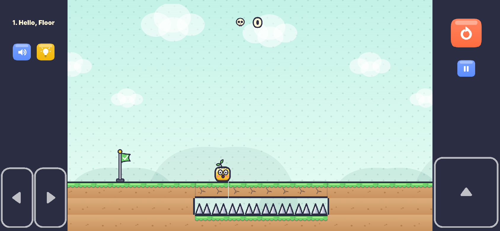
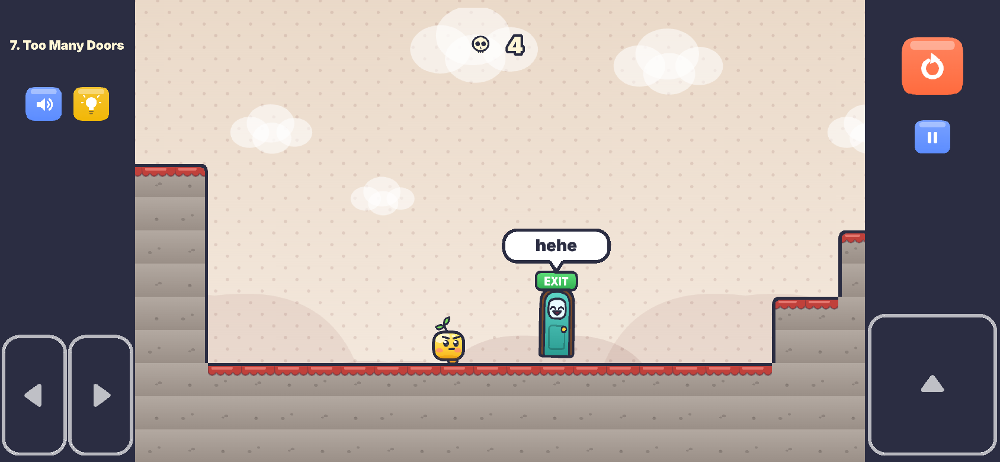

# Don't Trust the Door

A troll platformer where the level betrays you. Original web game by AtelierPro Aramyan Games.

Ten levels, ten different betrayals: the floor, coins, springs, the cave ceiling, your own
controls, gravity, the EXIT door itself, the camera, things that chase you, and finally the moving
platforms. Every level has its own idea, its own trap types (no trap type appears in two levels),
its own layout style and colour palette. Traps are surprising the first time and fair the second
time. Death restarts instantly (from the checkpoint flag once you have reached it); the death
counter is always on screen. There are no text hints – but each level gives you **one light bulb**:
press it once to see what the next trap does.

**Play:** https://rafikaramyan1987-ux.github.io/Dont-Trust-The-Door/ (phone: play in landscape)

<p>


</p>

10 levels (118–149 tiles wide for levels 1–7, 201–214 for the hard finale levels 8–10; 6–10 troll
moments each; a checkpoint in every level), title screen, level select, pause, restart, mute, hint,
saving. Everything (art, sound, music) is generated in code.

## Run it

```bash
npm install
npm run dev        # http://localhost:5173  (also reachable from a phone on the same Wi-Fi)
npm run build      # production build in dist/ (static files, ~1.5 MB)
npm run preview    # serve dist/
npm test           # validate levels → build → headless self-test (needs Playwright's Chromium:
                   # npx playwright install chromium)
```

Controls: **← → / A D** move · **Space / ↑ / W** jump (hold = higher) · **Esc / P** pause · **R** restart
(from the start of the level) · **M** mute. On touch screens, large semi-transparent buttons sit in
the side margins, outside the level; a big orange **restart** button sits on top of the right margin.
Holding ▲ gives exactly the same full jump as holding the jump key – each finger keeps the button it
pressed, even if it slides off the button while holding.

**Hint (light bulb):** one per level. Pressing it shows a short tip about the next trap ahead of you
and highlights that trap's area; then the bulb greys out. It comes back when you finish the level or
start it again from level select (dying or restarting does not give it back). It changes nothing
else. The only other text in the game is the move/jump instruction at the start of level 1, shown
once.

URL parameters: `?level=4` jumps straight to a level, `?touch=1` forces the touch controls on desktop,
`?unlock` (on the level-select screen) unlocks every level.

## Tech

- Vite + TypeScript + Phaser 3.90 (Arcade physics), WebGL with Canvas fallback.
- **Scrolling levels.** Levels are 18 tiles tall (40 px tiles) and up to 260 tiles wide. A world
  camera follows the hero smoothly (with a little look-ahead) and stays clamped to the level; a
  second UI camera draws the HUD, touch buttons and overlays in a fixed design space. Phones in
  landscape show ~22 tiles across (the hero is ~1.6× bigger than in the first slice) and the touch
  buttons live in side pillars that the world camera never draws into. Desktop shows the full
  18-tile height. Portrait phones get a "rotate your phone" message.
- **Terrain** is an auto-tiled Phaser tilemap built from a generated tileset (16 neighbour masks ×
  3 variants), so only visible tiles are drawn and no texture ever exceeds phone limits. Trap blocks
  are drawn with the same per-tile painter, so they are indistinguishable from the ground.
- **Fixed 60 Hz simulation.** The game advances in deterministic 1/60 s ticks (Arcade's world is
  stepped manually), independent of the display frame rate. That makes the recorded bot replays
  exact and the trap slow-motion free of side effects.
- Feel: coyote time, jump buffering, variable jump height, snappy acceleration, stronger fall gravity.
- **Checkpoint:** one flag per level. A death after touching it respawns there; the whole level is
  rebuilt so every trap is re-armed, except triggers marked `keep` that lie before the flag (the door
  that already fled stays where it ran to). The restart button always goes back to the start.
- Saving: unlocked levels, deaths per level, total deaths, mute and "tutorial seen" in
  `localStorage` (try/catch).
- **No soft-locks.** The level validator includes a static analyzer (`tests/softlock.mjs`) that
  explores every spot the hero can reach in every world state (each trap fired or not, moving
  platforms at intermediate positions, after gravity/zero-jump zones, springs, riding platforms) and
  proves that from each one the hero can still reach the EXIT – or die. A pit you can fall into
  but not jump out of, and can't die in, fails the build.

```
src/
  scenes/GameScene.ts   simulation, traps & triggers, cameras, HUD, checkpoint
  game/Hero.ts Door.ts  the two characters
  art.ts audio.ts       procedural textures, sound and music
  levels/*.json         ← the levels (generated by the builder, or hand-written)
tools/level-builder/    segments.mjs (troll set-pieces) + build.mjs (the 10 level recipes)
tests/                  validator, plans.json, recorded replays, self-test
tools/capture-media.mjs screenshots (and the trailer)
```

## Levels

| # | Level | Main idea | Trap types (used in no other level) | Palette |
|---|---|---|---|---|
| 1 | Hello, Floor | The floor is not what it seems | `sinking-step`, `fake-floor`, `collapsing-floor`, `crumbling-bridge` | Mint Meadow |
| 2 | Greedy Little Blob | "Safe" coins are traps | `biting-coin`, `coin-arc`, `cursed-coin`, `coin-trail` | Golden Hour |
| 3 | Spring Fever | Springs | `spring-ceiling`, `dud-spring`, `hidden-spring`, `sideways-spring` | Candy Clouds |
| 4 | Heavy Ceiling | Falling ceilings | `dropping-ceiling-spikes`, `crusher-slab`, `thwomp`, `tunnel-ceiling-spikes` | Deep Cave |
| 5 | Left Is Right | The controls betray you | `controls-swap`, `broken-jump`, `auto-run` | Neon Arcade |
| 6 | Upside Downer | Gravity | `gravity-flip`, `gravity-flip-back`, `low-gravity`, `heavy-gravity` | Twilight Tiles |
| 7 | Too Many Doors | The EXIT keeps changing its mind | `fake-exit`, `runaway-exit`, `exit-swap`, `hidden-exit` | Royal Castle |
| 8 | Screen Lies | The camera lies | `camera-freeze`, `screen-flip`, `tunnel-vision`, `fake-victory` | Midnight |
| 9 | Run! | Something is always chasing you | `rolling-ball`, `chasing-wall`, `rising-flood` | Lava |
| 10 | The Grand Betrayal | Moving platforms betray you | `shuttle-dive`, `shy-platform`, `blinking-platform`, `elevator-spikes` | Sunset |

| # | Width (tiles) | Bot win from start / checkpoint (s) | Troll moments |
|---|---|---|---|
| 1 | 118 | 16 / 8.2 | 7: The floor sags under you · Two fake floor tiles over spikes · Cracked floor crumbles if you stop on it · The bridge crumbles behind you · Two fake floor tiles over spikes (2) · The floor sags under you (2) · Cracked floor crumbles if you stop on it (2) |
| 2 | 142 | 18.3 / 10.5 | 7: A coin on the floor bites · The coin arc over the pit bites · Grabbing the lone coin makes spikes shoot up · The coin trail leads into a pit · A coin on the floor bites (2) · The coin arc over the pit bites (2) · Grabbing the lone coin makes spikes shoot up (2) |
| 3 | 135 | 19.1 / 8.5 | 6: The spring shoots you into ceiling spikes · The first spring is a dud · A spring pops out of the floor · A sideways spring flings you into spikes · A spring pops out of the floor (2) · The first spring is a dud (2) |
| 4 | 129 | 26.8 / 11.3 | 6: Ceiling spikes drop on you · The ceiling slab slams down · A ceiling block slams down in rhythm · The tunnel ceiling hides spikes · A ceiling block slams down in rhythm (2) · Ceiling spikes drop on you (2) |
| 5 | 149 | 19.2 / 12.3 | 6: Left and right swap · Jump stops working · You cannot stop running · Jump stops working (2) · Left and right swap (2) · You cannot stop running (2) |
| 6 | 121 | 16.1 / 8 | 6: Gravity flips – drifting lands you in ceiling spikes · Gravity flips back above a spike field · Floaty gravity – a full jump hits the ceiling · Heavy gravity – your jump is too weak · Floaty gravity – a full jump hits the ceiling (2) · Heavy gravity – your jump is too weak (2) |
| 7 | 125 | 17.1 / 10.8 | 6: A fake EXIT bites · The EXIT grows legs and runs away · The EXIT swaps itself for a fake · A fake EXIT bites (2) · The real EXIT hides inside the wall · A fake EXIT in front of the wall |
| 8 | 203 | 26.6 / 12.1 | 9: The camera stops following you · The screen turns upside down · The camera zooms in – tunnel vision · A fake "level clear" screen · The screen turns upside down (2) · The camera zooms in – tunnel vision (2) · A fake "level clear" screen (2) · The camera stops following you (2) · The screen turns upside down (3) |
| 9 | 214 | 30.2 / 15.1 | 8: A spiked ball rolls after you · A spike wall chases you · Spikes rise from the floor · A spiked ball rolls after you (2) · A spike wall chases you (2) · Spikes rise from the floor (2) · A spiked ball rolls after you (3) · A spike wall chases you (3) |
| 10 | 201 | 29 / 14.6 | 10: The shuttle dives into the void · The platform dodges your jump · The platforms blink away · The elevator rises into ceiling spikes · The platform dodges your jump (2) · The shuttle dives into the void (2) · The elevator rises into ceiling spikes (2) · The platforms blink away (2) · The platform dodges your jump (3) · The shuttle dives into the void (3) |

Bot times are a frame-perfect run at full speed with zero hesitation (deterministic sim; the
real-time run in the self-test is within ~1 s of these); a person's first clean run is much slower.
Levels 8–10 are on average 1.57× as wide as levels 1–7 and have the most troll moments.

## Level data format

Each level is one JSON file in [`src/levels/`](src/levels), loaded automatically and ordered by file
name. The map is **18 rows of equal length (32–260 characters)**:

| char | meaning | char | meaning |
|---|---|---|---|
| `.` | empty | `#` | solid block |
| `^ v < >` | spikes (pointing up/down/left/right) | `=` | jump pad |
| `o` | coin (genuine) | `P` | player start |
| `D` | the real EXIT (bottom tile; hangs upside-down if attached to a ceiling) | `F` | fake EXIT (bites) |
| `C` | checkpoint flag (exactly one) | `a`–`z` (not `o`/`v`) | tile of a named **group** |
| `*` | spiked ball | | |

`hints` (text in the level) is allowed only in level 1, for the move/jump instructions.

```jsonc
{
  "id": 2, "name": "Solid Ground?", "world": 0, "winMessage": "The floor lied. Repeatedly.",
  "deathQuips": ["The floor lied.", "Still lying."],
  "idea": "\"Safe\" coins are traps",                                 // the level's one main idea
  "map": ["...", "..."],
  "groups": { "a": { "tile": "#", "cover": [[12,16],[13,16],[14,16]] } },
  "triggers": [ { "when": { "touch": "a" }, "do": [ { "fall": "a", "shake": 3 } ], "troll": "t1" } ],
  "trolls": [ { "id": "t1", "name": "The floor collapses into spikes", "type": "collapsing-floor",
                "x": 12, "w": 3, "hint": "Don't stop on the cracked floor." } ],   // x/w: tiles; hint: the bulb text
  "fakeExits": { "57": "t4" }                                       // F at tile x 57 → troll t4
}
```

**Groups:** `tile` (`#`, a spike char, `=`, `o`), `hidden` (starts retracted / invisible), `fake`
(blocks you fall through, spikes that are harmless and squash flat), `trapCoin` (coin turns into a
spiky ball), `look` (`cracked` / `bolted` hints), `cover` (extra tiles drawn as part of the group, e.g.
hiding a pit), `troll` (troll id credited when its built-in trick fires), `launch: [vx, vy]` (a
sideways spring), `dud: true` (a spring that does nothing).

**Triggers** fire once per attempt. `when`: `zone: [x, y, w, h]` (tiles, may be fractional; optional
`airborne` / `grounded`), `touch: "a"`, `start: true`, or `after: "<trigger id>"`. Options: `delay`
(ticks, 60 = 1 s), `every` (repeat the actions every N ticks – rhythmic traps), `troll` (troll id),
`keep` (see Checkpoint above). **Actions:**

| action | effect |
|---|---|
| `{ "fall": "a", "shake": 6 }` | group shakes, then drops away |
| `{ "pop": "a" }` / `{ "retract": "a" }` | hidden spikes shoot out / go back |
| `{ "move": "a", "by": [0, 4], "ticks": 14, "deadly": true, "returnAfter": 50, "returnTicks": 40 }` | slide a group; `deadly` crushes while moving |
| `{ "chase": "w", "vel": [3.4, 0], "untilX": 23 }` | move a group continuously (px per tick; `untilY` for vertical) |
| `{ "doorRun": [[26,14],[28,12]], "speed": 7, "hehe": 28 }` | the EXIT says "hehe", grows legs and runs along tile waypoints |
| `{ "gravity": "flip" }` / `"normal"` | flip gravity |
| `{ "controls": "flip" \| "nojump" \| "autorun" \| "normal" }` | swap left / right, disable jumping, force running |
| `{ "gravityScale": 0.45 }` | floaty (< 1) or heavy (> 1) gravity |
| `{ "camera": "freeze" \| "follow" \| "flip" \| "unflip" \| "zoom" \| "unzoom" }` | the camera lies |
| `{ "fakeClear": true }` | a fake "level clear" card |
| `{ "show": "a" }` / `{ "hide": "a" }` | make a group appear / vanish (vanishing platforms) |
| `{ "say": "text", "at": "hero" \| "door" \| [x, y] }`, `{ "doorHehe": 40 }`, `{ "shake": 4 }`, `{ "slowmo": 20 }`, `{ "scare": true }` | effects |

Every trap action adds the juice automatically (shocked face, short slow motion, sound); repeats of a
rhythmic trap stay quiet.

### Making levels fast: the level builder

The shipped levels are composed from **troll set-pieces** in
[`tools/level-builder/segments.mjs`](tools/level-builder/segments.mjs). Every segment belongs to
exactly one level (`l1Sink`, `l2Bite`, `l3Dud`, … `l10Blink`), plus shared start / checkpoint / end
pieces. Each segment draws its tiles, registers its triggers and its trolls (`name`, `type`, region
and hint), and writes the bot plan that beats it and the plan that falls for it. The builder refuses
a trap type that is used by two levels. A level is a list of segments in
[`build.mjs`](tools/level-builder/build.mjs):

```js
segments: [S.start, S.l1Sink, S.l1Fake, S.l1Collapse, S.checkpoint, S.l1Bridge, ...]
```

```bash
npm run levels    # regenerate src/levels/*.json and tests/plans.json (+ validate)
npm run record    # regenerate, build, record frame-exact bot replays (tests/replays/)
npm test          # validate + self-test
```

## Self-test

- `npm run test:levels` – every level: 18 equal rows, width 32–260, legal characters, one `P`, one
  `D`, one `C`, groups and trigger references valid, ≥ 5 trolls, each troll wired up and with a
  type, region and hint; each trap type used by one level only; different palettes and ideas; text
  only in level 1; **no soft-locks** (static analysis, see Tech).
- `tests/replays/level-NN.json` – recorded frame-exact inputs: `win` (from the start), `cp` (from
  the checkpoint) and one replay per trap that must kill.
- `tests/run-selftest.mjs` – against the production build in headless Chromium: the level-design
  rules again (no soft-locks; the analyzer must also find the reported pit in a copy of the old
  level 1 in `tests/fixtures/`); every level won in real time by the bot at a steady frame rate; won
  again from the start and from the checkpoint in the deterministic sim; every trap replay kills
  exactly once; **every listed troll moment fires**; the hint button names the next trap, greys
  out, survives deaths/restarts, resets on level select / next level and changes nothing (the bot
  wins on the same tick with it pressed); the level-1 instructions show once only and no text
  appears after deaths; checkpoint respawn lands on the flag (the runaway door stays away) and
  restart returns to the start; death counter / HUD / save / reload / blocked storage; phone
  landscape (~22 tiles visible, buttons outside the level, real multi-touch input, **▲ held = the
  same full jump as the keyboard, also with the thumb sliding off**, restart button visible and
  ≥ 44 px), portrait "rotate" message, desktop layout; no console errors; build < 10 MB.
  CI (`.github/workflows/ci.yml`) runs all of this on every push.

### Results (latest run)

**171/171 checks passed** (2026-11-13, `npm test`). Highlights:

| | check | result |
|---|---|---|
| ✅ | soft-lock detector finds the reported pit in the OLD level 1 (cols 82-94) | col 87 row 14 |
| ✅ | every level has its own idea, palette and trap types (no type in two levels) | 38 trap types, 10 ideas, 10 palettes |
| ✅ | no text hints in the levels (only the level-1 controls), none after deaths | level 1: ← →  move / SPACE / ▲  jump |
| ✅ | levels 8-10 are ~1.5× as long as levels 1-7 | avg 1-7: 131 tiles; 8-10: 203, 214, 201 (×1.57) |
| ✅ | levels 8-10 have more troll moments | 1:7 2:7 3:6 4:6 5:6 6:6 7:6 8:9 9:8 10:10 |
| ✅ | bot completes level 1 in real time | won, 17.3 s, 60 fps, p95 frame 17.4 ms |
| ✅ | bot completes level 2 in real time | won, 18.9 s, 60 fps, p95 frame 17.4 ms |
| ✅ | bot completes level 3 in real time | won, 19.7 s, 60 fps, p95 frame 18.1 ms |
| ✅ | bot completes level 4 in real time | won, 29.2 s, 60 fps, p95 frame 18.0 ms |
| ✅ | bot completes level 5 in real time | won, 20.7 s, 60 fps, p95 frame 18.2 ms |
| ✅ | bot completes level 6 in real time | won, 17.6 s, 60 fps, p95 frame 17.5 ms |
| ✅ | bot completes level 7 in real time | won, 18.1 s, 60 fps, p95 frame 17.8 ms |
| ✅ | bot completes level 8 in real time | won, 29.3 s, 60 fps, p95 frame 17.6 ms |
| ✅ | bot completes level 9 in real time | won, 33.3 s, 60 fps, p95 frame 17.3 ms |
| ✅ | bot completes level 10 in real time | won, 30.1 s, 60 fps, p95 frame 17.4 ms |
| ✅ | stable ~60 fps during the real-time bot run | avg 60.0 fps, worst level avg 60.0 fps (480×270, software WebGL) |
| ✅ | progress saved: all 10 levels completed/unlocked | {"unlocked":10,"completed":10} |
| ✅ | death counter equals number of deaths | 67 == 67 |
| ✅ | HUD death counter shows the total | HUD "67" |
| ✅ | save survives a page reload | totalDeaths=67, per level {"1":5,"2":7,"3":6,"4":6,"5":6,"6":6,"7":4,"8":9,"9":8,"10":10} |
| ✅ | blocked localStorage is handled (try/catch) | ok |
| ✅ | level 1: the restart button goes back to the very start | x=100 |
| ✅ | level 7: the door that already ran away stays away after the checkpoint respawn | door x 1220 → 2429 (running), after respawn 2740 (its destination) |
| ✅ | level 10: the restart button goes back to the very start | x=100 |
| ✅ | hint button is available at the start of a level | {"used":false,"btn":{"alpha":1,"enabled":true,"visible":true}} |
| ✅ | hint is used once, then the button greys out | "Those ceiling spikes drop – step back and wait until they go up again.", alpha 0.35 |
| ✅ | dying or restarting does not give the hint back | after death true, after restart true |
| ✅ | hint resets when the level is replayed from level select or the next level starts | {"select":false,"next":{"level":2,"used":false}} |
| ✅ | level-1 move/jump instructions are shown once, never again | first visit: ← →  move / SPACE / ▲  jump; second visit: 0 texts |
| ✅ | no text hint appears after deaths in any level | texts after 6 deaths per level: 0,0,0,0,0,0,0,0,0,0 |
| ✅ | restart after death is instant (< 0.3 s) | 268 ms |
| ✅ | CPU time per frame at 1280×720 is far below the 16.7 ms budget | 0.48 ms/frame |
| ✅ | level rebuild on restart is cheap | 2.76 ms (restart delay itself is 16 ticks = 267 ms) |
| ✅ | desktop 1280×720: level fills the screen, no touch buttons | {"zoom":1,"touch":false} |
| ✅ | desktop: restart button is visible on screen | 78×78 px at (1047, 1) |
| ✅ | phone landscape: camera shows ~22 tiles across and follows the hero | 22.0 tiles visible, hero 19.6 css px tall (was 12.5 px when the whole 32-tile level was shown) |
| ✅ | phone landscape 844×390: buttons visible, ≥44 px, outside the level area | level spans 114–730 css px; buttons left 52×99@29, right 52×99@85, jump 106×117@787 |
| ✅ | touch: holding ▶ moves the hero right | x 100 → 227, vx 300 |
| ✅ | touch: second finger on jump makes the hero jump (multi-touch) | min y 464 (ground 586) |
| ✅ | touch: holding ▲ gives exactly the same full jump as holding the keyboard key | keyboard 122.5 px, ▲ 122.5 px, ▲ with thumb sliding into the level 122.5 px |
| ✅ | phone landscape: restart button is visible, ≥44 px, outside the level area | 63×63 css px at (755, 27) |
| ✅ | phone portrait 390×844 shows "rotate your phone" | {"display":"flex","text":"Rotate your phone"} |
| ✅ | no console errors |  |
| ✅ | production build under 10 MB | 1.55 MB |
| ✅ | no soft-locks in any of the 10 levels | 10/10 levels, 1800, 612, 488, 3319, 262, 210, 400, 334, 3656, 7783 reachable spots |
| ✅ | every level completable from the start and from its checkpoint | 20/20 |
| ✅ | every troll moment fires | 10/10 levels |
| ✅ | 67 trap replays each kill exactly once | see test-results/selftest.json |
| ✅ | hint button shows the next trap and changes nothing | 10/10 levels (same winning tick) |
| ✅ | death after the checkpoint respawns at the flag | 10/10 levels |

Headless Chromium has no GPU (WebGL is rasterised on the CPU), so the real-time run uses a small
window and the CPU cost of a full 1280×720 frame is measured separately; on a phone the GPU does the
drawing. On CI runners the timing checks are reported but not enforced.

## Media

- Screenshots (phone landscape 844×390 with the touch controls): [`docs/media/screens/`](docs/media/screens)
  – title, hero expressions, level select, a troll moment from every level, the hint button, the
  checkpoint, desktop.
  Regenerate with `npm run build && node tools/capture-media.mjs --screens-only`.
- Trailer: [`docs/media/trailer-9x16.mp4`](docs/media/trailer-9x16.mp4) – 20 s vertical video of troll
  moments from the current levels (`node tools/capture-media.mjs --video-only`).

## Deployment

`.github/workflows/pages.yml` builds every push to `main` and publishes `dist/` to the `gh-pages`
branch (GitHub Pages: Settings → Pages → Deploy from a branch → `gh-pages` / root).
